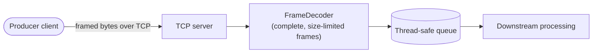

# 🌌 Aether Stream Layer


A lightweight, high-throughput message streaming component built in C++20 for Linux environments. It serves as the low-latency ingestion backbone for the **Aether Platform** ecosystem.

---

## 📖 Overview

`aether-stream-layer` is an AP-oriented (Availability / Partition tolerance) message streaming engine. Designed around an in-memory architecture, it prioritizes immediate availability and fast write acknowledgement (`ACK`) over synchronous disk persistence.

### 🧠 Core Architecture Concepts

- **Concurrency & Safety**: In-memory message buffers using Modern C++ thread synchronization primitives (`std::mutex`, `std::condition_variable`).
- **POSIX Networking**: Non-blocking/blocking TCP socket communication handling Producer-Consumer network traffic.
- **Data Ingestion**: High-speed message queuing designed to isolate network ingestion from downstream processing.

### 🔀 Data Flow (simplified)



---

## 🚀 Quick Start

### 📋 Prerequisites

- **OS**: Linux (Ubuntu / WSL2)
- **Toolchain**: `cmake` (>= 3.16), `g++` with C++20 support

### 🔨 Build

```bash
cmake -B build
cmake --build build
```

### ▶️ Run

```bash
# Terminal 1: start the server
./build/aether_server 8080

# Terminal 2: send a message with the CLI
./build/aether_cli 127.0.0.1 8080 "hello aether"
```

After a build, everything lands in `build/`:

| Executable | What it is |
| :--- | :--- |
| `aether_server` | The server (takes the port as its argument) |
| `aether_cli` | Command-line client for talking to the server |
| `aether_tests` | GoogleTest unit tests |
| `aether_frame_torture` | Network torture test (coalescing, fragmentation, DoS) |

---

## 🔬 Testing & Diagnostics

### ✅ Unit tests

```bash
# Run every unit test directly
./build/aether_tests

# Or through CTest (one entry per TEST(), so failures are easy to pinpoint)
ctest --test-dir build --output-on-failure
```

> 💡 **Tips**
> - Run a single test: `./build/aether_tests --gtest_filter=<Suite>.<Test>`, or `ctest --test-dir build -R <name>`
> - `ctest --test-dir` needs CMake 3.20+. On older versions use `cd build && ctest --output-on-failure`.

### 🌪️ Network torture test

TCP coalescing and fragmentation:

```bash
./build/aether_frame_torture
```

### 🧪 Sanitizers

Pick one sanitizer per build directory (`AETHER_SANITIZE`):

| Sanitizer | `AETHER_SANITIZE` | Catches |
| :--- | :---: | :--- |
| AddressSanitizer (ASan) | `address` | Memory errors: out-of-bounds, use-after-free, leaks |
| ThreadSanitizer (TSan) | `thread` | Data races |
| UndefinedBehaviorSanitizer (UBSan) | `undefined` | Undefined behavior: overflow, bad shifts, misaligned access |

```bash
# AddressSanitizer
cmake -B build-asan -DAETHER_SANITIZE=address && cmake --build build-asan
ctest --test-dir build-asan --output-on-failure

# ThreadSanitizer
cmake -B build-tsan -DAETHER_SANITIZE=thread && cmake --build build-tsan
ctest --test-dir build-tsan --output-on-failure

# UndefinedBehaviorSanitizer
cmake -B build-ubsan -DAETHER_SANITIZE=undefined && cmake --build build-ubsan
ctest --test-dir build-ubsan --output-on-failure
```

### 🔍 System call tracing

```bash
strace -f -o trace.txt ./build/aether_server 8080
```

---

## 📁 Project Structure

```text
AETHER-STREAM-LAYER/
├── docs/                          # Detailed technical documentation (Protocol specification, phases)
│   ├── phase-1.md
│   ├── phase-2.md
│   └── PROTOCOL.md
├── include/                       # Core system header files (.hpp)
│   ├── client.hpp                 # AetherClient: RAII TCP client with length-prefixed framing (send_frame / recv_frame)
│   ├── file_descriptor.hpp        # RAII wrapper for file/socket descriptor management
│   ├── frame.hpp                  # Frame definition and FrameDecoder (DoS mitigation)
│   ├── logger.hpp                 # Thread-safe multi-threaded logging system
│   ├── net_io.hpp                 # Safe network I/O operations (send_all, recv_some, EINTR)
│   ├── tcp_server.hpp             # TCP server initialization and connection acceptance loop
│   └── thread_safe_queue.hpp      # Thread-safe concurrent queue
├── src/                           # Implementation source files (.cpp) for core modules
│   ├── frame.cpp
│   ├── logger.cpp
│   ├── main.cpp
│   ├── net_io.cpp
│   └── tcp_server.cpp
├── tests/                         # GoogleTest unit tests, built into the aether_tests binary
│   ├── test_fd.cpp
│   ├── test_frame.cpp
│   ├── test_net_io.cpp
│   └── test_queue.cpp
├── tools/                         # Diagnostic tools and utility clients
│   ├── aether_cli.cpp             # Command-line client (built on AetherClient) for interacting with the server
│   └── aether_frame_torture.cpp   # Torture test suite (coalescing, fragmentation, DoS)
├── CMakeLists.txt                 # Project-wide CMake build configuration
├── LICENSE                        # Source code license
└── README.md                      # Project overview and user guide
```

---

## 📚 Documentation & Notes

For detailed technical notes, architecture decision records (ADR), and phase specifications, refer to:

- [Phase 1: Echo Server & Basic Networking](docs/phase-1.md)
- [Phase 2: Message Broker & Protocol Design](docs/phase-2.md)
- [Protocol Specification (Framing)](docs/PROTOCOL.md)