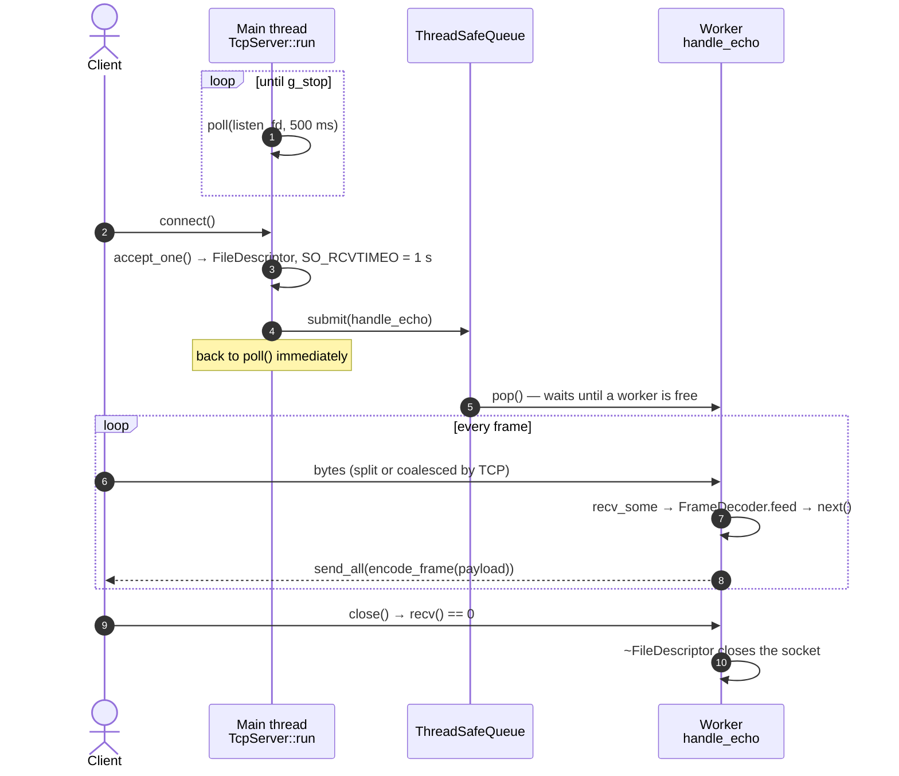

<div align="center">



<br>

[](https://github.com/krss-sys/aether-stream-layer/actions/workflows/build.yml)
[](https://github.com/krss-sys/aether-stream-layer/actions/workflows/lint.yml)


<br><br>

**A from-scratch C++20 TCP transport: length-prefixed framing, a blocking thread pool and a thread-safe queue — built on raw POSIX sockets, with zero runtime dependencies.**<br>
The foundation of an AP-oriented message streaming layer for the **Aether Platform**.

[Overview](#-overview) · [Architecture](#-architecture) · [Wire protocol](#-wire-protocol) · [Quick start](#-quick-start) · [Testing & quality](#-testing--quality) · [Design notes](#-design-notes) · [Roadmap](#-roadmap)

</div>

<br>


## 🧭 Overview

Aether Stream Layer is the networking core that a streaming/broker layer will sit on. It answers the unglamorous questions first: *how do you get whole messages out of a TCP byte stream, survive hostile input, serve many clients with bounded resources, and shut down cleanly?*

| **8** | **1 MiB** | **4 B** | **18** | **4** | **2** |
|:-----:|:---------:|:-------:|:------:|:-----:|:-----:|
| pool workers | max frame payload | big-endian length header | unit tests, plus a 3-scenario torture test | CI configs: Release · ASan · TSan · UBSan | static analyzers: cppcheck · clang-tidy |

> [!IMPORTANT]
> **Where the project stands.** Phases 1–3 are complete and the code base has been through an 11-day cleanup audit. What exists is the **transport foundation**: framing, accept loop, thread pool, graceful shutdown, and a test / sanitizer / CI harness. The server currently **echoes every frame back**.
> **Not built yet:** the queue-backed ingestion path, `ACK`s, topics/commands, and an `epoll` event loop — see the [roadmap](#-roadmap). The AP-style design (stay available, acknowledge fast, no synchronous disk persistence) is the *goal*, not a shipped feature.

### What's in the box

- 🧱 **Framing** — `Length (4 B, big-endian) | Payload`, with a hard 1 MiB cap enforced *before* any allocation.
- 🧵 **ThreadPool + ThreadSafeQueue** — fixed workers pulling tasks from a mutex + condition-variable queue; exceptions are contained per task.
- 🔌 **POSIX TCP server** — `poll()`-driven accept loop, per-connection `SO_RCVTIMEO`, peer address logging.
- 🛡️ **RAII everywhere** — a move-only `FileDescriptor` owns every socket; no manual `close()` on error paths.
- 🧯 **Graceful shutdown** — `SIGINT` / `SIGTERM` flip an atomic flag; the server winds down and exits `0`.
- 🧪 **Test & diagnostics kit** — GoogleTest suite, a network torture tool, a CLI client, sanitizer builds and `strace` recipes.


## 🔌 Architecture



**How one connection is served**

1. **Accept.** `TcpServer::run()` polls the listening socket every 500 ms (so it can notice a shutdown request). On `POLLIN`, `accept_one()` wraps the new socket in a `FileDescriptor` *immediately*, sets a 1 s `SO_RCVTIMEO`, and extracts the peer `ip:port`.
2. **Dispatch.** The accept loop submits `handle_echo(conn)` to the `ThreadPool`, i.e. pushes a task into the `ThreadSafeQueue`, and goes straight back to `poll()`. It never blocks on a client.
3. **Serve.** A worker pops the task and **owns the connection until it closes**: `recv_some` → `FrameDecoder` → `encode_frame` → `send_all`.
4. **Log safely.** Only the frame size and a ≤ 64-byte preview (non-printable bytes shown as `?`) are logged, never the raw payload, so a client can't inject log lines.
5. **Stop.** On `SIGINT` / `SIGTERM` the accept loop exits, blocked reads notice the flag on their next 1 s timeout tick, the pool closes its queue and joins every worker.

> [!NOTE]
> **Blocking by design.** One connection pins one worker, so at most 8 clients are served at once; a 9th is already `accept()`-ed but waits in the queue until a worker frees up (measured in the [Phase 3 worker-exhaustion test](docs/phase-3.md): 4 workers, 5 persistent connections). An idle timeout and an `epoll` event loop are deliberately deferred to Phase 4 

<details>
<summary><b>Show the connection lifecycle as a sequence diagram</b></summary>



</details>


## 📡 Wire protocol



TCP is a byte stream with no message boundaries, so every message is one **frame**:

| Field | Size | Encoding | Notes |
|:--|:--:|:--|:--|
| **`Length`** | 4 B | `uint32_t`, **big-endian** (`htonl` / `ntohl`) | Counts the payload only; must be ≤ 1 MiB (1,048,576) |
| **`Payload`** | `Length` B | raw bytes | Empty payloads are legal |

`"hello"` on the wire: `00 00 00 05 68 65 6c 6c 6f`

**Hostile-input guards**

- The decoder checks `Length` against `kMaxFrameSize` as soon as the 4-byte header is complete. A frame over 1 MiB sets an error flag and the server **closes the connection**, because once a length can't be trusted there is no way to find the next frame.
- `encode_frame()` refuses oversized payloads (throws), and `AetherClient::send_frame()` returns `false` for them.
- Both sides use the same constant, so client and server can't disagree about the limit.

Full spec: [`docs/PROTOCOL.md`](docs/PROTOCOL.md). A command/topic layout (`Length | Command(1) | TopicLength(2 BE) | Topic | Payload`) is sketched there as **v1, planned — not implemented**.


## 🚀 Quick start

**Requirements:** Linux (Ubuntu / WSL2), `cmake` ≥ 3.16, a C++20 compiler (`g++`; CI uses Ubuntu 24.04).

```bash
git clone https://github.com/krss-sys/aether-stream-layer.git
cd aether-stream-layer

cmake -B build
cmake --build build -j
```

> [!NOTE]
> The first configure downloads GoogleTest v1.14.0 through CMake `FetchContent`, so it needs network access, even if you only want the server.

**Run it**

```bash
# terminal 1 — server (listens on 0.0.0.0:8080, logs to stderr)
./build/aether_server

# terminal 2 — send one framed message, print the echo
./build/aether_cli 127.0.0.1 8080 "hello aether"
# → hello aether
```

What the server prints for that request:

```text
[08:46:30.819] [INFO] [140243444512576] Accepted connection from 127.0.0.1:33028
[08:46:30.819] [INFO] [140243411912384] Client connected
[08:46:30.820] [INFO] [140243411912384] Received frame, size = 12, preview = hello aether
[08:46:30.820] [INFO] [140243411912384] Client disconnected
```

The first line comes from the accept thread, the rest from the worker that served the connection (note the different thread ids). Press <kbd>Ctrl</kbd>+<kbd>C</kbd> to stop: the server exits with code `0` within about a second, bounded by the 1 s receive-timeout tick.

**What gets built** (all in `build/`)

| Binary | Purpose |
|:--|:--|
| `aether_server` | The echo server |
| `aether_cli` | Command-line client: `aether_cli <ip> <port> <message>` (validates the port, 1–65535) |
| `aether_frame_torture` | Network torture test: coalescing, fragmentation, hostile length |
| `aether_tests` | GoogleTest unit tests |

**Configuration** lives in [`include/config.hpp`](include/config.hpp). There are no CLI flags or env vars yet: edit a constant and rebuild.

| Constant | Value | Meaning |
|:--|:--:|:--|
| `kDefaultPort` | `8080` | Listening port (also used by the torture tool) |
| `kWorkerCount` | `8` | ThreadPool size = max concurrently served clients |
| `kRecvBufferSize` | `4096` | Per-read buffer in `handle_echo` |
| `kRecvTimeoutSec` | `1` | `SO_RCVTIMEO`; each expiry re-checks the stop flag |
| `kPollTimeoutMs` | `500` | Accept-loop `poll()` timeout |


## 🧪 Testing & quality

### ✅ Unit tests (GoogleTest, 18 cases)

```bash
./build/aether_tests                          # run everything directly
ctest --test-dir build --output-on-failure    # or via CTest, one entry per TEST()
./build/aether_tests --gtest_filter='FrameDecoderTest.*'   # a single suite
```

> `ctest --test-dir` needs CMake ≥ 3.20. On older versions: `cd build && ctest --output-on-failure`.

| File | Cases | What it pins down |
|:--|:--:|:--|
| `test_frame.cpp` | 6 | Encode (incl. empty payload) · single frame · **sticky packets** · **byte-by-byte feed** · `0xFFFFFFFF` header → error |
| `test_queue.cpp` | 6 | Push/pop · **MPMC stress** (4 producers × 4 consumers, 100,000 items) · `close()` wakes a blocked consumer · `pop_for` timeouts |
| `test_pool.cpp` | 2 | 1,000 tasks on 4 workers · immediate destruction joins cleanly |
| `test_fd.cpp` | 2 | `FileDescriptor` pipe I/O · move semantics and `release()` |
| `test_net_io.cpp` | 1 | `recv_exact` reassembles a fragmented stream |
| `test_client_reconnect.cpp` | 1 | Repeated `connect()` doesn't leak file descriptors |

### 🌪️ Network torture test

With the server running:

```bash
./build/aether_frame_torture
```

| Scenario | What it does | Pass condition |
|:--|:--|:--|
| **Coalescing** | Three frames in a single `send()` | The send succeeds (the server log shows all three frames decoded) |
| **Fragmentation** | One frame, **1 byte every 50 ms** (`TCP_NODELAY`) | Echo is byte-identical to the frame sent |
| **Malicious header** | `FF FF FF FF` length prefix | Server closes the connection |

### 🧼 Sanitizers

Pick one sanitizer per build directory (`AETHER_SANITIZE`):

| Sanitizer | `AETHER_SANITIZE` | Catches |
|:--|:--:|:--|
| AddressSanitizer | `address` | Out-of-bounds, use-after-free, leaks |
| ThreadSanitizer | `thread` | Data races |
| UndefinedBehaviorSanitizer | `undefined` | Overflow, bad shifts, misaligned access |

```bash
cmake -B build-asan  -DAETHER_SANITIZE=address   && cmake --build build-asan  -j && ctest --test-dir build-asan  --output-on-failure
cmake -B build-tsan  -DAETHER_SANITIZE=thread    && cmake --build build-tsan  -j && ctest --test-dir build-tsan  --output-on-failure
cmake -B build-ubsan -DAETHER_SANITIZE=undefined && cmake --build build-ubsan -j && ctest --test-dir build-ubsan --output-on-failure
```

### 🤖 Continuous integration

Both workflows run automatically on pushes and pull requests to `main`.

| Workflow | What runs |
|:--|:--|
| [**Build and Test**](.github/workflows/build.yml) | Matrix of **Release · ASan · TSan · UBSan** on Ubuntu 24.04 (Ninja); `ctest` with a 120 s timeout. TSan gets a `vm.mmap_rnd_bits=28` workaround for the ASLR crash on new kernels. |
| [**Static Analysis**](.github/workflows/lint.yml) | `cppcheck` (warning / performance / portability) and `clang-tidy` (`bugprone`, `concurrency`, `performance`, `modernize` checks, configured in [`.clang-tidy`](.clang-tidy)) over `src/` and `tools/`. |

The build uses `-Wall -Wextra -Wpedantic`. Code style is pinned by [`.clang-format`](.clang-format).

### 🔍 Watching the syscalls

```bash
strace -f -o trace.txt ./build/aether_server
```

`-f` follows threads: you'll see the eight pool workers spawned once at startup (`clone3`), `socket` → `bind` → `listen` → `accept` on the main thread, and `recvfrom` / `sendto` (with `MSG_NOSIGNAL`) on whichever worker picked up the connection. [Phase 1](docs/phase-1.md) has an annotated walkthrough, but it traces the older thread-per-connection design.


## 🧠 Design notes


<details open>
<summary><b>Resource safety</b></summary>

- **Every socket has an owner.** `FileDescriptor` is a move-only RAII wrapper. `accept_one()` wraps the fd *before* calling `setsockopt`, so a throw can't leak it. `AetherClient` owns its socket the same way, and `connect()` disconnects first, so reconnecting can't leak (guarded by `test_client_reconnect.cpp`).
- **Memory is bounded by a validated value.** Nothing is sized from a peer-supplied length until it has been checked against `kMaxFrameSize`.
- **Workers survive bad tasks.** The worker loop catches exceptions per task and logs them, so one failure can't take down the pool or abort the server.

</details>

<details open>
<summary><b>Shutdown and resilience</b></summary>

- **Signal handlers do one thing:** set `std::atomic<bool> g_stop` (in [`stop_flag.hpp`](include/stop_flag.hpp), so `net_io` doesn't depend on the server). Blocking reads use a 1 s `SO_RCVTIMEO` and re-check the flag on every expiry (`EAGAIN`), which is what lets idle workers exit.
- **The accept loop doesn't die on transient errors.** Failed `accept()`s are logged and the loop continues, with a 100 ms back-off on `EMFILE`. A failing `poll()` is surfaced as an error instead of silently breaking the loop.
- **Short reads and writes are handled.** `recv_exact` and `send_all` loop over partial transfers, and all three I/O helpers retry on `EINTR`. `send_all` uses `MSG_NOSIGNAL`, so a vanished peer yields an error instead of `SIGPIPE`.

</details>

<details>
<summary><b>Layering and hygiene</b></summary>

- **Clear seams:** `handle_echo` lives in `session.{hpp,cpp}`, separate from the client; tunables sit in `config.hpp`; the frame limit has a single definition in `frame.hpp`.
- **Honest docs:** [Phase 1](docs/phase-1.md) is marked historical (thread-per-connection was replaced by the ThreadPool), and anything unbuilt is labeled *planned*.
- **Parked on purpose:** `ThreadSafeQueue::pop_for` is kept for future timeout handling and is currently exercised only by tests; the plan is to drop it if it's still unused after two phases (DECISIONS #8).

</details>


## 📁 Project structure

<details open>
<summary><b>Show the tree</b></summary>

```text
aether-stream-layer/
├── include/                        # Public headers
│   ├── client.hpp                  # AetherClient: RAII TCP client (connect / send_frame / recv_frame)
│   ├── config.hpp                  # Tunables: port, worker count, buffer size, timeouts
│   ├── connection_guard.hpp        # RAII log of client connect / disconnect
│   ├── file_descriptor.hpp         # Move-only RAII wrapper for POSIX fds
│   ├── frame.hpp                   # kMaxFrameSize, encode_frame, FrameDecoder
│   ├── logger.hpp                  # Thread-safe logger (stderr)
│   ├── net_io.hpp                  # send_all / recv_some / recv_exact (EINTR-safe)
│   ├── session.hpp                 # handle_echo: the per-connection handler
│   ├── stop_flag.hpp               # Global atomic shutdown flag
│   ├── tcp_server.hpp              # Accept loop + signal setup
│   ├── thread_pool.hpp             # Fixed-size pool of std::jthread workers
│   └── thread_safe_queue.hpp       # Mutex + condition_variable queue
├── src/                            # Implementations
│   ├── client.cpp                  # AetherClient implementation
│   ├── frame.cpp                   # Frame encoding & decoding logic
│   ├── logger.cpp                  # Logger implementation
│   ├── main.cpp                    # Server entry point
│   ├── net_io.cpp                  # Safe network I/O primitives
│   ├── session.cpp                 # Connection handler loop
│   └── tcp_server.cpp              # TCP socket and polling implementation
├── tests/                          # GoogleTest suites -> aether_tests
│   ├── test_client_reconnect.cpp   # Reconnect & fd leak tests
│   ├── test_fd.cpp                 # FileDescriptor RAII tests
│   ├── test_frame.cpp              # Frame parsing and codec tests
│   ├── test_net_io.cpp             # Network I/O robustness tests
│   ├── test_pool.cpp               # ThreadPool concurrency tests
│   └── test_queue.cpp              # ThreadSafeQueue MPMC stress tests
├── tools/                          # Utilities & stress test tools
│   ├── aether_cli.cpp              # Command-line client
│   └── aether_frame_torture.cpp    # Coalescing / fragmentation / hostile-header test
├── docs/                           # Documentation & specifications
│   ├── PROTOCOL.md                 # Wire format spec (v0) + planned v1
│   ├── phase-1.md                  # Echo server & basic networking (historical)
│   ├── phase-2.md                  # Protocol design & framing
│   ├── phase-3.md                  # Concurrency & ThreadPool
│   └── assets/                     # README graphics (self-hosted SVG)
├── CMakeLists.txt                  # Library `aether_core` + server, cli, torture, tests
├── Doxyfile                        # API docs: `doxygen Doxyfile`
├── LICENSE                         # MIT
└── README.md                       # Project overview & instructions
```

</details>


## 🎯 Roadmap

| | Phase | Delivered / planned | Notes |
|:-:|:--|:--|:--|
| ✅ | **1 · Echo server** | TCP echo, thread-per-connection, `strace`-verified syscall lifecycle | Days 7–13 · [notes](docs/phase-1.md) |
| ✅ | **2 · Protocol & framing** | Big-endian length prefix, 1 MiB cap, `recv_some` / `recv_exact`, `FrameDecoder` | Days 14–23 · [notes](docs/phase-2.md) |
| ✅ | **3 · Concurrency** | Blocking ThreadPool, `ThreadSafeQueue`, ASan / TSan verification | Days 29–33 · [notes](docs/phase-3.md) |
| ⬜ | **Ingestion path** | Wire the queue between network ingestion and downstream processing; add `ACK` | Designed, not wired in yet |
| ⬜ | **Protocol v1** | `Command (1 B) · TopicLength (2 B BE) · Topic · Payload` | [PROTOCOL.md §5](docs/PROTOCOL.md) |


## 📚 Documentation

| Document | What's inside |
|:--|:--|
| [`PROTOCOL.md`](docs/PROTOCOL.md) | Frame layout, byte order, safety limits, worked example, planned v1 |
| [`phase-1.md`](docs/phase-1.md) | `recv()` semantics, thread-per-connection, syscall tracing *(historical)* |
| [`phase-2.md`](docs/phase-2.md) | Why big-endian, why 1 MiB, `recv_some` vs `recv_exact`, buffer management |
| [`phase-3.md`](docs/phase-3.md) | ThreadPool design, worker-exhaustion test, condvar and shutdown internals |

<br>

<div align="center">


Released under the [MIT License](LICENSE) · © 2026 Kross

</div>
