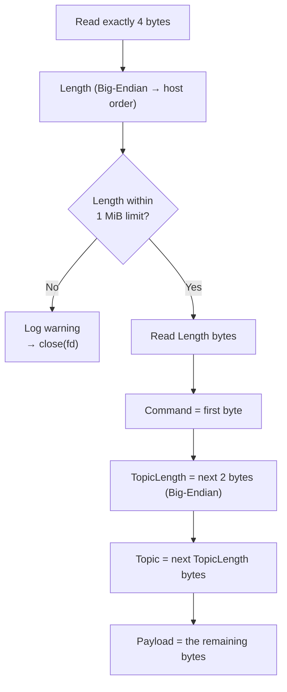

# 📡 Aether Protocol Specification (Framing)

This document defines the wire protocol contract between the `aether` client and broker/server. Because TCP is a continuous **byte stream** with no inherent message boundaries, a custom framing mechanism is required to split and reconstruct discrete messages safely.

> **At a glance**
> - 🧱 Every message is one **frame**: `Length | Command | TopicLength | Topic | Payload`
> - 🔢 Multi-byte integers (`Length`, `TopicLength`) are **Big-Endian**
> - 🛑 `Length` is capped at **1 MiB** to stop memory-exhaustion attacks; a violation closes the connection

---

## 1. 🧱 Frame Structure

Every message transmitted over the TCP socket follows this exact binary layout:

| Field | Size (Bytes) | Type / Endianness | Description |
| :--- | :--- | :--- | :--- |
| **`Length`** | 4 Bytes | `uint32_t` / **Big-Endian** | Total byte length of the remaining frame (from `Command` to the end of `Payload`). Must not exceed 1 MiB (1,048,576 bytes). |
| **`Command`** | 1 Byte | `uint8_t` / Enum | Command code (e.g., `1` for `PRODUCE`, `2` for `CONSUME`, etc.). |
| **`TopicLength`** | 2 Bytes | `uint16_t` / **Big-Endian** | Length (in bytes) of the subsequent `Topic` string. |
| **`Topic`** | Variable | UTF-8 String | The target topic name (e.g., `"orders"`). |
| **`Payload`** | Variable | Raw Bytes / UTF-8 | The actual message content or body. |

### 🗺️ Layout

Byte offsets are on the first line. The first three fields are fixed-size, so `Topic` always starts at offset 7.

```text
 0            4         5             7                     7+TopicLength
┌────────────┬─────────┬─────────────┬─────────────────────┬────────────────────┐
│   Length   │ Command │ TopicLength │        Topic        │       Payload      │
│  4 bytes   │ 1 byte  │ 2 bytes     │ TopicLength bytes   │ remaining bytes    │
│ uint32 BE  │ uint8   │ uint16 BE   │ UTF-8               │ raw / UTF-8        │
└────────────┴─────────┴─────────────┴─────────────────────┴────────────────────┘
             └─────────────────── Length counts these bytes ────────────────────┘
```

### 🧮 How the Fields Fit Together

Since `Length` covers everything after itself, the size of the `Payload` follows directly from the other fields:

```text
Payload size = Length - 1 (Command) - 2 (TopicLength) - TopicLength
```

---

## 2. 🔢 Byte Order & Endianness

- All multi-byte integer fields (`Length`, `TopicLength`) are transmitted in **Network Byte Order (Big-Endian)**.
- Both client and broker must explicitly convert integers using `htons()` / `htonl()` on transmission and `ntohs()` / `ntohl()` on reception.

| Field | Size | On transmission | On reception |
| :--- | :---: | :---: | :---: |
| **`Length`** | 4 Bytes | `htonl()` | `ntohl()` |
| **`TopicLength`** | 2 Bytes | `htons()` | `ntohs()` |

`Command` is a single byte, and `Topic` / `Payload` are plain byte sequences, so none of them needs byte-order conversion.

---

## 3. 🛑 Safety Limits

- **Maximum `Length`:** The `Length` field is restricted to **1 MiB** (1,048,576 bytes) to prevent Denial-of-Service (DoS) attacks via memory exhaustion from malformed or malicious huge length prefixes. The server allocates its buffer (e.g., a `std::vector` for the topic and payload) based on this value, so the check happens right after `Length` is read.
- **Size on the wire:** `Length` does not include its own 4 bytes, so a frame is at most 1 MiB + 4 bytes in total.
- **On violation:** The server logs a warning and closes the TCP connection (`close(fd)`). TCP is a continuous byte stream, so once a `Length` cannot be trusted there is no reliable way to find where the next frame begins.



---

## 4. 🧪 Example: `PRODUCE` to `"orders"` with payload `"a"`

| Field | Value | Bytes (hex) |
| :--- | :--- | :--- |
| **`Length`** | `10` (1 + 2 + 6 + 1) | `00 00 00 0a` |
| **`Command`** | `1` (`PRODUCE`) | `01` |
| **`TopicLength`** | `6` | `00 06` |
| **`Topic`** | `"orders"` | `6f 72 64 65 72 73` |
| **`Payload`** | `"a"` | `61` |

Full frame on the wire (14 bytes: 4 for `Length` + 10 that follow it):

```text
00 00 00 0a 01 00 06 6f 72 64 65 72 73 61
```