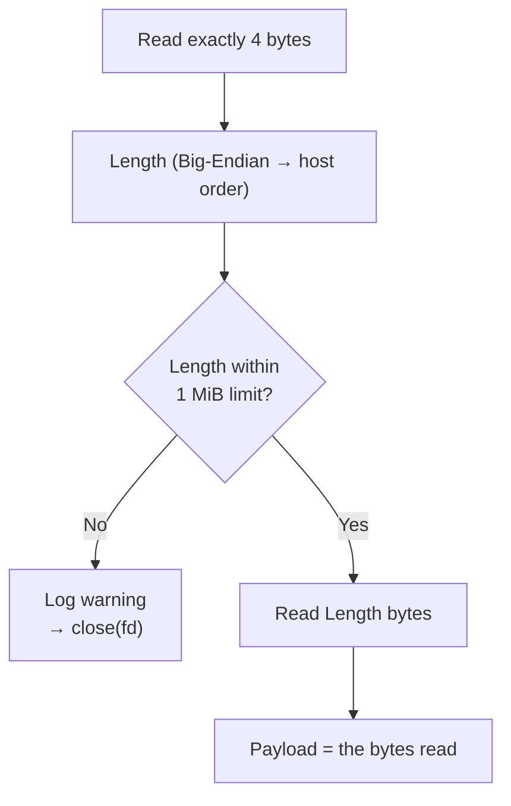

# 📡 Aether Protocol Specification (Framing)

This document defines the wire protocol contract between the `aether` client and server. Because TCP is a continuous **byte stream** with no inherent message boundaries, a custom framing mechanism is required to split and reconstruct discrete messages safely.

> **At a glance**
> - 🧱 Every message is one **frame**: `Length | Payload`
> - 🔢 Multi-byte integers (`Length`) are **Big-Endian**
> - 🛑 `Length` is capped at **1 MiB** to stop memory-exhaustion attacks; a violation closes the connection

---

## 1. 🧱 Frame Structure (Current Implementation - v0)

Every message transmitted over the TCP socket follows this exact binary layout:

| Field | Size (Bytes) | Type / Endianness | Description |
| :--- | :--- | :--- | :--- |
| **`Length`** | 4 Bytes | `uint32_t` / **Big-Endian** | Total byte length of the `Payload` that follows. Must not exceed 1 MiB (1,048,576 bytes). |
| **`Payload`** | Variable | Raw Bytes | The actual message content. |

### 🗺️ Layout

Byte offsets are on the first line. The first field is fixed-size (4 bytes), so `Payload` always starts at offset 4.

```text
 0            4                              4 + Length
┌────────────┬──────────────────────────────────────────┐
│   Length   │                 Payload                  │
│  4 bytes   │              Length bytes                │
│ uint32 BE  │               raw bytes                  │
└────────────┴──────────────────────────────────────────┘
             └────────── Length counts these bytes ──────┘
```

> 🧠 `Length` counts only the payload, which is why a frame is at most 1 MiB + 4 bytes in total.

---

## 2. 🔢 Byte Order & Endianness

- The `Length` field is transmitted in **Network Byte Order (Big-Endian)**.
- Both client and server must explicitly convert integers using `htonl()` on transmission and `ntohl()` on reception.

| Field | Size | On transmission | On reception |
| :--- | :---: | :---: | :---: |
| **`Length`** | 4 Bytes | `htonl()` | `ntohl()` |

`Payload` is a plain byte sequence, so it does not need byte-order conversion.

---

## 3. 🛑 Safety Limits

- **Maximum `Length`:** The `Length` field is restricted to **1 MiB** (1,048,576 bytes) to prevent Denial-of-Service (DoS) attacks via memory exhaustion.
- **Size on the wire:** `Length` does not include its own 4 bytes, so a frame is at most 1 MiB + 4 bytes in total.
- **On violation:** The server logs a warning and closes the TCP connection (`close(fd)`). Once a `Length` cannot be trusted, there is no reliable way to find where the next frame begins.



---

## 4. 🧪 Example: `"hello"` payload

| Field | Value | Bytes (hex) |
| :--- | :--- | :--- |
| **`Length`** | `5` | `00 00 00 05` |
| **`Payload`** | `"hello"` | `68 65 6c 6c 6f` |

Full frame on the wire (9 bytes: 4 for `Length` + 5 for `Payload`):

```text
00 00 00 05 68 65 6c 6c 6f
```

---

## 5. 🔮 Future Work (v1 - Planned, Not Implemented)

The protocol is designed to eventually support a message broker with commands and topics. The planned v1 layout is:

`Length | Command (1B) | TopicLength (2B BE) | Topic (N bytes) | Payload`

This is **not** implemented in the current code. It is documented here as a design target for future phases.
