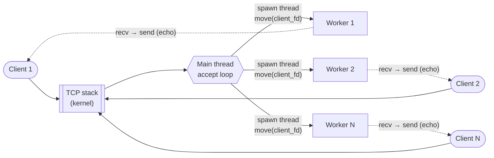
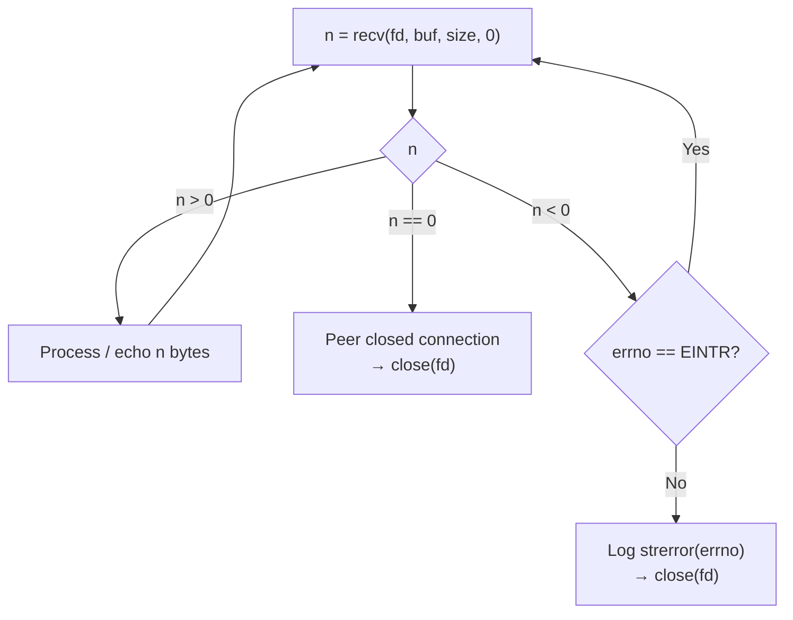
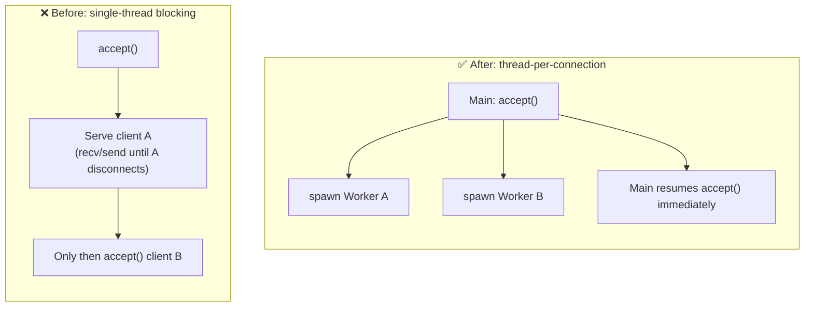
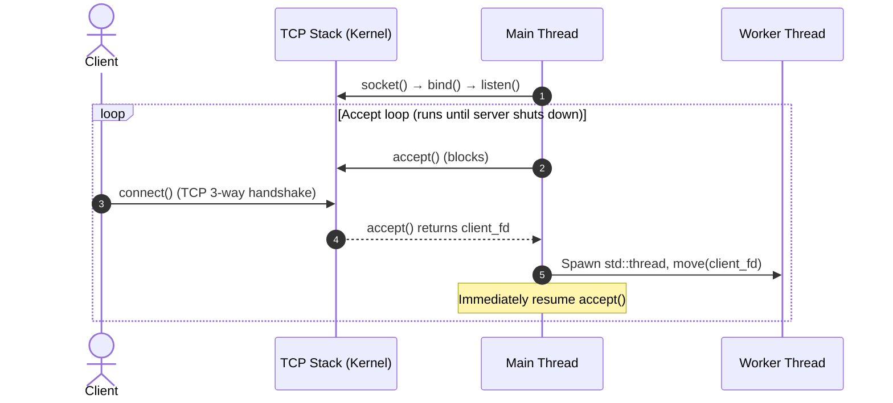
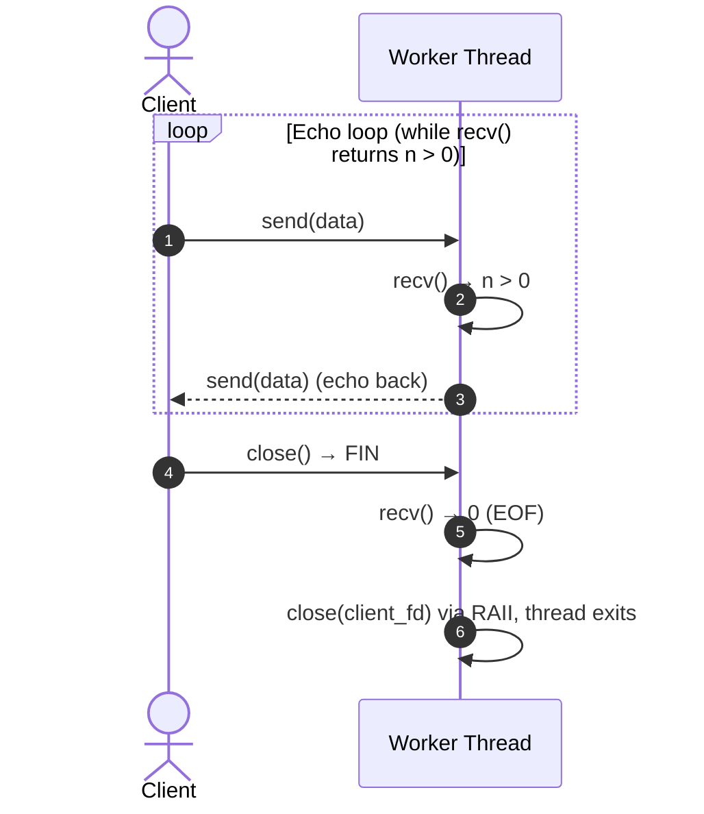

# 🔌 Phase 1: Echo Server & Basic Networking

## 📝 Aether Network Engine - Technical Notes

> **TL;DR - What did Phase 1 deliver?**
> - 🧱 A working TCP echo server: `socket → bind → listen → accept`
> - 🧵 Moved from a single-threaded blocking model to **thread-per-connection** (`std::thread`)
> - 🔬 Verified the full syscall lifecycle with `strace` instead of guessing

---

## 🗺️ Big Picture



---

## 📥 Day 07 - `recv()` Return Values & Semantics

The `recv(fd, buf, count, flags)` system call reads incoming socket data. Its return value `n` indicates the socket status:

| Return Value | Meaning | Action Required |
| :--- | :--- | :--- |
| **`n > 0`** | Successfully received `n` bytes of data. | Process buffer contents. |
| **`n == 0`** | Peer closed its sending side (TCP FIN received, i.e. EOF). | Close the client socket. |
| **`n < 0`** | Error occurred during read. | If `errno == EINTR`, retry the call. Otherwise log via `errno` / `strerror` and close the socket. |

### 🧭 Decision Tree



### 🧩 Read Loop Pattern

```cpp
char buf[4096];
for (;;) {
    ssize_t n = ::recv(fd, buf, sizeof buf, 0);
    if (n > 0) {
        // Echo n bytes back (note: send() can also be partial, see Gotcha 2)
    } else if (n == 0) {
        break;                        // Peer closed the connection
    } else {
        if (errno == EINTR) continue; // Interrupted by a signal, retry
        std::perror("recv");
        break;
    }
}
```

> ⚠️ **Gotcha 1:** `recv()` may return **fewer** bytes than requested. TCP is a byte stream, not a message stream, so a single `recv()` does not correspond to a single "message". This is why a framing layer is introduced later (see `PROTOCOL.md`).
>
> ⚠️ **Gotcha 2:** `send()` can also be partial. To echo all `n` bytes, loop on `send()` until everything is written (and handle `EINTR` there too).
>
> ⚠️ **Gotcha 3:** On a **non-blocking** socket, `n < 0` with `EAGAIN` / `EWOULDBLOCK` means "no data yet", not a failure.

---

## 🧵 Day 09 - Thread-per-Connection Architecture

Transitioned from a single-threaded blocking model to a multi-threaded architecture (`std::thread`). The main thread only runs the `accept()` loop and delegates each client connection to a dedicated worker thread.

### ⚖️ Before vs. After



| | Single-thread | Thread-per-connection |
| :--- | :---: | :---: |
| Concurrent clients | ❌ Served one at a time | ✅ |
| Code complexity | 🟢 Low | 🟢 Low |
| One slow client blocks the server | 🔴 Yes | 🟢 No |
| Scales to thousands of connections | 🔴 No | 🟡 Hard: each connection costs a thread (stack + context switches) |

> 💡 The last row is the reason systems later move to I/O multiplexing (`epoll`).

### 🔄 Execution Flow

**1. Accepting connections (Main Thread)**



**2. Handling one client (Worker Thread)**



> 🛡️ **Key point:** `client_fd` is **moved** into the worker and owned by an RAII wrapper (`FileDescriptor`). When the worker exits, the fd is closed automatically, so there is no need to remember a manual `close()` on every error path.

---

## 🔍 Day 13 - Syscall Lifecycle & Phase 1 Verification

Verified system-level execution flow using `strace`:

```bash
strace -f -o trace.txt ./build/aether_server 8080
```

- `-f`: follow child threads created by the process.
- `-o trace.txt`: write the log to a file. Each line is prefixed with the **PID/TID**, which makes it possible to tell the main thread apart from the workers.

### 📋 Server System Call Sequence

| # | Syscall | Executing Context | Description / Purpose |
| :-: | --- | --- | --- |
| 1 | `socket()` | Main Thread | Creates the endpoint file descriptor for IPv4 TCP communication. |
| 2 | `setsockopt()` | Main Thread | Sets `SO_REUSEADDR` so the port can be re-bound immediately after a restart. |
| 3 | `bind()` | Main Thread | Binds the listening socket to the configured IP address and port (`8080`). |
| 4 | `listen()` | Main Thread | Marks the socket as passive, ready to accept incoming connections. |
| 5 | `accept()` / `accept4()` | Main Thread | Blocks until a client connects, then returns a new `client_fd`. |
| 6 | `clone3()` / `clone()` | Main Thread | Spawns a new worker thread (`std::thread`) for the connection. |
| 7 | `recvfrom()` | Worker Thread | Reads the byte stream from the client. Returns `0` on EOF (FIN). |
| 8 | `sendto()` | Worker Thread | Echoes the received bytes back to the client. |
| 9 | `close()` | Worker Thread | Closes `client_fd` on client disconnect to release resources. |

> 📎 **Reading the log:** on Linux, libc's `recv()` and `send()` usually appear in `strace` as `recvfrom()` and `sendto()`. Whether you see `clone3()` or `clone()` depends on the glibc version.

### 👀 What the Log Looks Like (illustrative)

> PIDs and fd numbers below are illustrative. Compare against a real `trace.txt` from the server.

```text
1000  socket(AF_INET, SOCK_STREAM, IPPROTO_IP) = 3
1000  setsockopt(3, SOL_SOCKET, SO_REUSEADDR, [1], 4) = 0
1000  bind(3, {sa_family=AF_INET, sin_port=htons(8080), ...}, 16) = 0
1000  listen(3, 128) = 0
1000  accept4(3, ...) = 4                 <- client connects
1000  clone3({...}, 88) = 1001            <- spawn worker (TID 1001)
1001  recvfrom(4, "hello", 4096, 0, ...) = 5
1001  sendto(4, "hello", 5, 0, ...) = 5   <- echo
1001  recvfrom(4, "", 4096, 0, ...) = 0   <- EOF
1001  close(4) = 0                        <- RAII closes the fd
```

How to read it: **PID `1000`** is the main thread (accept, spawn). **TID `1001`** is the worker (recv, send, close).

### ✅ Verification Checklist

- [x] Main thread only performs `socket → bind → listen → accept → clone`
- [x] `recv` / `send` / `close` run on a thread other than main
- [x] `recvfrom()` returns `0` before `close()` is called (fd closed at the right moment)

### 💡 Key Takeaways

* **Multi-threading verification:** the `-f` flag traced thread creation via `clone3()`, confirming that each client connection is handed off to a separate worker thread, away from the accept loop.
* **Resource hygiene:** confirmed `close()` on `client_fd` upon client disconnection, consistent with the `FileDescriptor` RAII wrapper. To rule out fd leaks more rigorously, also check `ls /proc/<pid>/fd` or `lsof -p <pid>` after many clients have disconnected.