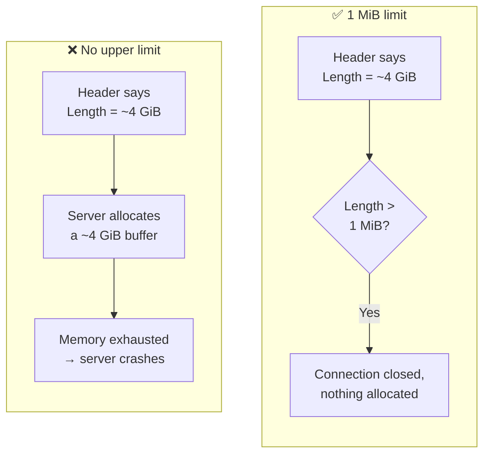
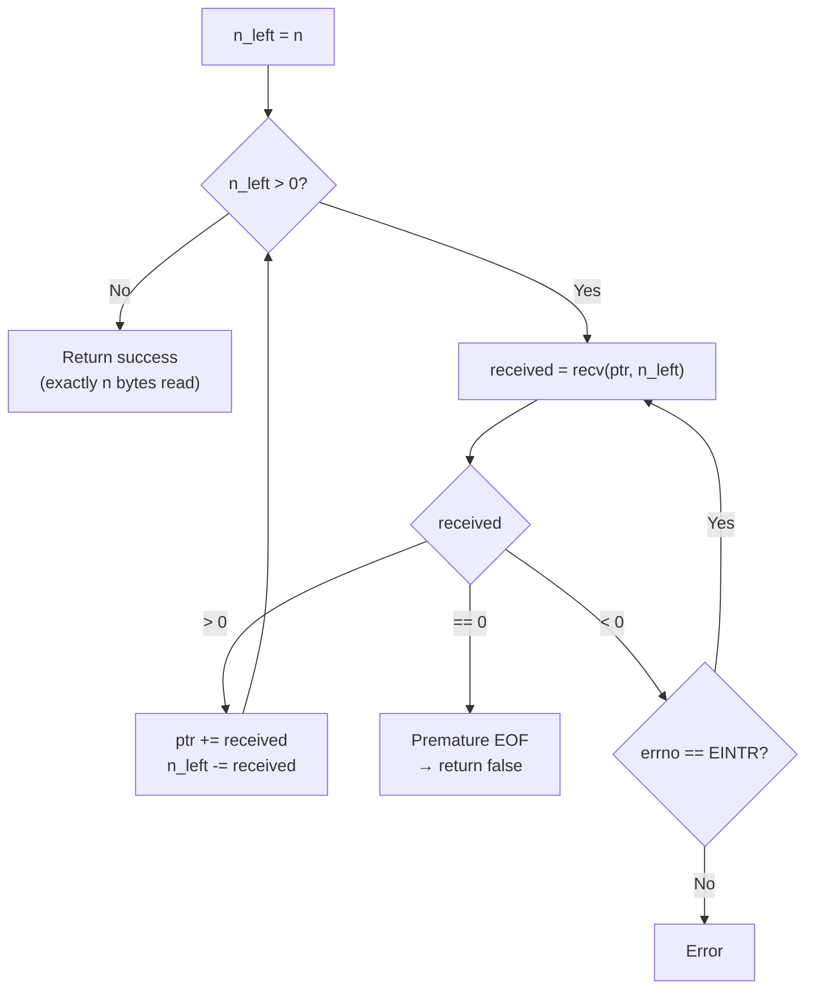

<!-- historical -->
# 📨 Phase 2: Protocol Design & Framing

> **TL;DR - What does this phase cover?**
> - 🔢 Multi-byte integers go on the wire in **Big-Endian** (Network Byte Order).
> - 🛑 Every frame is capped at **1 MiB** so a bad `Length` can never exhaust memory.
> - 📥 **Server worker uses `recv_some`** into a fixed 4096-byte scratch buffer and feeds chunks into a stateful `FrameDecoder`; **Client uses `recv_exact`** (loops until it reads the exact number of bytes).
> - 🧱 Payload buffers are only allocated **after** `Length` is validated against `kMaxFrameSize` inside `FrameDecoder`.

---

## 📐 Day 14 - Protocol Design Rationale & Framing

### 1. Why Big-Endian (Network Byte Order)?

- **Standardization:** Network protocols (TCP/IP, IP headers, DNS) universally adopt Big-Endian as the standard Network Byte Order.
- **Consistency across platforms:** Different CPU architectures store multi-byte integers in memory differently. x86/x64 are Little-Endian, while some processors (e.g., certain ARM configurations) are Big-Endian. By enforcing Big-Endian on the wire, any client and server running on completely different hardware architectures can communicate without misinterpreting integer values (like `Length`).

The same value, two byte orders:

```text
Value 10 as uint32_t

Big-Endian (on the wire):      00 00 00 0a    <- most significant byte first
Little-Endian (x86 memory):    0a 00 00 00    <- least significant byte first

```

A reader that assumed the wrong order would see `0a 00 00 00` as 167,772,160 instead of 10.

### 2. Why a Maximum Frame Size Limit of 1 MiB?

* **Denial-of-Service (DoS) prevention:** If there is no upper limit on the `Length` field, a malicious or buggy client could send a packet specifying a length of about 4 GiB (the `uint32_t` maximum). A naive server might try to allocate a massive buffer in RAM to read this payload, instantly exhausting server memory and crashing the server.
* **Resource predictability:** Restricting individual messages to 1 MiB (1,048,576 bytes = $2^{20}$) ensures that memory allocations remain bounded, predictable, and safe.



### 3. Frame Structure (Current Implementation - v0)

The current protocol is simple: `[Length (4 bytes BE)] [Payload (N bytes)]`. The `Length` field only counts the payload (not including itself).

Example: Payload `"hello"` (5 bytes).

* Hex stream: `00 00 00 05 68 65 6c 6c 6f`
* Layout:

```text
 0             4                               9
┌─────────────┬───────────────────────────────┐
│ Length (4B) │         Payload (5B)          │
├─────────────┼───────────────────────────────┤
│ 00 00 00 05 │ 68 65 6c 6c 6f ("hello")      │
└─────────────┴───────────────────────────────┘

```

> 🧠 `Length` counts only the payload, which is why it is `5` and not `9`.

---

## 📥 Day 21 - `recv_some` vs `recv_exact` (Network I/O Stream Guarantees)

### 1. Functional Divergence

|  | `recv_some` | `recv_exact` |
| --- | --- | --- |
| **Behavior** | Thin wrapper around the POSIX `recv` system call. Returns whatever chunk is currently available in the TCP socket receive buffer (1 byte up to the requested capacity). | Enforces strict stream framing by looping over `recv` calls until exactly `n` bytes are accumulated in the destination buffer. |
| **Result** | Number of bytes read (`> 0`), EOF (`== 0`), or error (`< 0`). | Success once `n` bytes are read. Premature EOF (`received == 0`) is a failure state (`false`). |
| **Bookkeeping** | None needed. | Pointer arithmetic (`ptr += received`), remaining length (`n_left -= received`), and signal interruption (`EINTR`) handling. |
| **Use case** | General stream reading where message boundaries are not predetermined. **Used by the server worker (`handle_echo` in `session.cpp`) to feed `FrameDecoder`.** | Protocol frame decoding when reading a known fixed-size 4-byte header followed by an exact payload read. **Used by the client (`AetherClient::recv_frame`).** |

### 2. How `recv_exact` Loops



### 3. Architectural Rationale

TCP delivers a raw byte stream, meaning frame boundaries are not preserved: a single frame may arrive fragmented across multiple `recv` calls, or multiple frames may coalesce into a single read.

To handle this cleanly without protocol desynchronization, the client and server take two complementary approaches:

* **Client (`recv_exact`):** Uses a straightforward request-response flow where reading the exact 4-byte header first, then reading the exact `Length` payload bytes is simple and predictable.
* **Server (`recv_some` + `FrameDecoder`):** Reads arbitrary chunks (up to 4096 bytes) as soon as the OS socket buffer has data, and delegates boundary tracking, partial header accumulation, and frame reassembly to a stateful `FrameDecoder`.

---

## 🧠 Day 23 — Buffer Management

### 1. Decoupling Socket Reads from Frame Assembly

Because TCP has no message boundaries, the server (`session.cpp`) does not try to read exact frame sizes directly from the socket. Instead, it separates **socket I/O** from **frame parsing** using a fixed-size read buffer and a stateful `FrameDecoder`:

1. **Read into a fixed 4096-byte scratch buffer:** `session.cpp` calls `recv_some` with a stack-allocated 4096-byte buffer, pulling whatever bytes are available on the socket in one syscall.
2. **Feed chunks into `FrameDecoder`:** The raw bytes are pushed into `FrameDecoder`, which accumulates bytes until at least 4 header bytes are available.
3. **Validate `Length` before reserving payload memory:** As soon as 4 header bytes are assembled, `FrameDecoder` decodes `Length` (Big-Endian) and checks it against `kMaxFrameSize` (1 MiB) *before* allocating or reserving storage for the payload.
4. **Accumulate and emit complete frames:** Once validated, `FrameDecoder` buffers incoming bytes until the full `Length` payload arrives, then emits the complete frame (while retaining any trailing bytes belonging to the next pipelined frame).

| Stage | Buffer / Memory Behavior | Constraint |
| --- | --- | --- |
| Socket read (`session.cpp`) | 4096-byte fixed stack buffer | Independent of peer input |
| Header accumulation (`FrameDecoder`) | Fixed 4-byte header state | Waits until all 4 bytes arrive across chunks |
| Validate `Length` (`FrameDecoder`) | 0 bytes payload allocated (compare only) | `Length <= kMaxFrameSize` (1 MiB) |
| Payload assembly (`FrameDecoder`) | Bounded by validated `Length` | Only allocated/reserved after validation passes |

The key security property remains intact: **no payload allocation happens before validation**. A header claiming ~4 GiB is rejected the instant its 4th byte arrives, with zero payload memory allocated — the same DoS mitigation described in Day 14 §2, enforced inside `FrameDecoder`.

### 2. Why Chunked Reads + Stateful `FrameDecoder` Matter

Using a 4096-byte `recv_some` loop paired with `FrameDecoder` solves both security and streaming edge cases:

* **Syscall efficiency:** If a client pipelines many small frames (e.g., 10-byte messages), a single `recv_some` call reads all of them into the 4096-byte buffer at once rather than issuing two `recv` syscalls per frame.
* **Safe partial header handling:** Even if a 4-byte header arrives split across multiple TCP segments (e.g., 2 bytes in one `recv_some` call and 2 bytes in the next), `FrameDecoder` waits until all 4 bytes are present before decoding and validating `Length`.
* **Bounded memory footprint:** A malicious peer cannot trigger an unbounded allocation on initial read because the socket buffer is fixed at 4096 bytes and payload storage is strictly gated by `Length <= kMaxFrameSize`.

### 3. Reflection

The through-line of Phase 2 is that **every buffer allocated is bounded by a value that has already been validated**. The server's socket read buffer is fixed at compile time (4096 bytes), header parsing is fixed at 4 bytes, and frame payload storage is bounded by `Length <= kMaxFrameSize` (1 MiB). Nothing the peer sends can trigger an allocation larger than 1 MiB, and no payload memory is allocated before the bound is checked.
