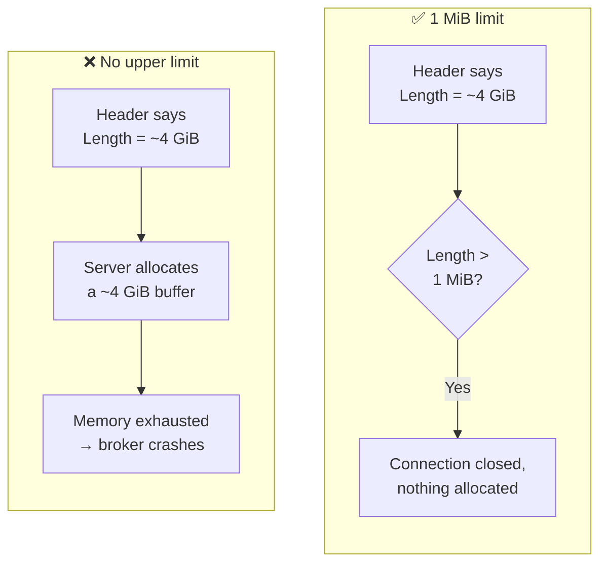
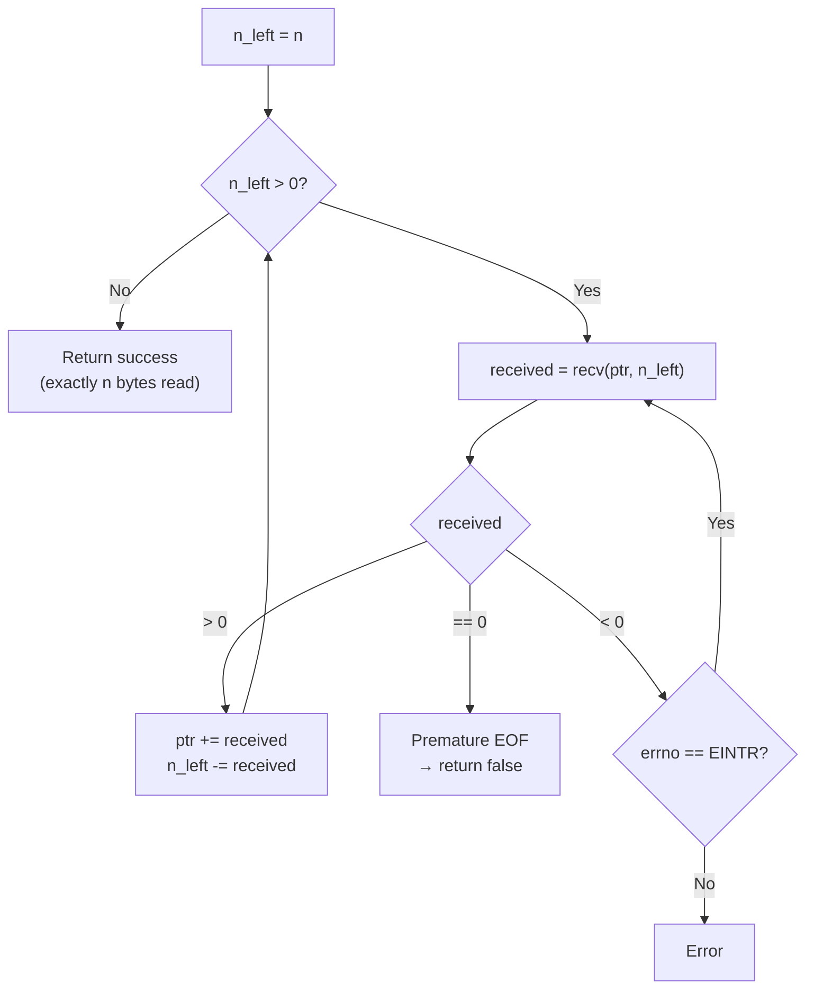
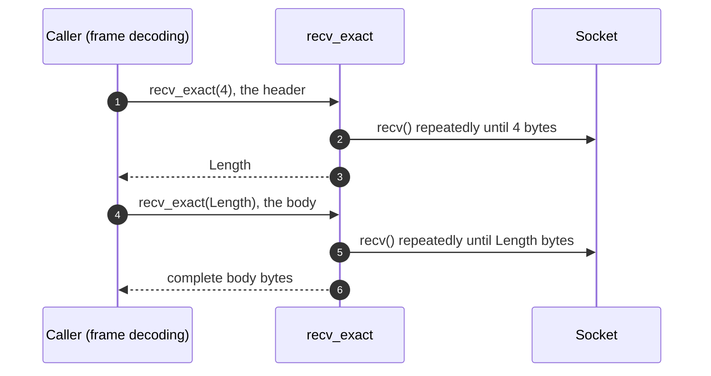

# 📨 Phase 2: Message Broker & Protocol Design

> **TL;DR - What does this phase cover?**
> - 🔢 Multi-byte integers go on the wire in **Big-Endian** (Network Byte Order)
> - 🛑 Every frame is capped at **1 MiB** so a bad `Length` can never exhaust memory
> - 🧮 Worked example: the `PRODUCE` frame for topic `"orders"` + payload `"a"`, byte by byte
> - 📥 `recv_exact` loops until it has exactly `n` bytes, unlike `recv_some` which returns whatever is available
> - 🧱 Buffers are only allocated **after** `Length` is validated against `kMaxFrameSize`

---

## 📐 Day 14 - Protocol Design Rationale & Framing

### 1. Why Big-Endian (Network Byte Order)?

- **Standardization:** Network protocols (TCP/IP, IP headers, DNS) universally adopt Big-Endian as the standard Network Byte Order.
- **Consistency across platforms:** Different CPU architectures store multi-byte integers in memory differently. x86/x64 are Little-Endian, while some processors (e.g., certain ARM configurations or network processors) are Big-Endian. By enforcing Big-Endian on the wire, any client and server running on completely different hardware architectures can communicate without misinterpreting integer values (like `Length` or `TopicLength`).

The same value, two byte orders:

```text
Value 10 as uint32_t

Big-Endian (on the wire):      00 00 00 0a    <- most significant byte first
Little-Endian (x86 memory):    0a 00 00 00    <- least significant byte first
```

A reader that assumed the wrong order would see `0a 00 00 00` as 167,772,160 instead of 10.

### 2. Why a Maximum Frame Size Limit of 1 MiB?

- **Denial-of-Service (DoS) prevention:** If there is no upper limit on the `Length` field, a malicious or buggy client could send a packet specifying a length of about 4 GiB (the `uint32_t` maximum). A naive server might try to allocate a massive buffer in RAM (`std::vector` or string) to read this payload, instantly exhausting server memory and crashing the broker.
- **Resource predictability:** Restricting individual messages to 1 MiB (1,048,576 bytes = 2^20) ensures that memory allocations remain bounded, predictable, and safe for high-throughput streaming environments.



### 3. Hex Dump Exercise Example (`PRODUCE` command)

For a message producing to topic `"orders"` with payload `"a"`:

| Field | Offset | Size | Type / Value | Hex Stream (Big-Endian) | Calculation / Notes |
| :--- | :---: | :---: | :--- | :--- | :--- |
| **`Length`** | 0 | 4 Bytes | `uint32_t` (= 10) | `00 00 00 0a` | Total bytes following the Length field (1 + 2 + 6 + 1 = 10) |
| **`Command`** | 4 | 1 Byte | `PRODUCE` (`1`) | `01` | Fixed command code for `PRODUCE` |
| **`TopicLength`** | 5 | 2 Bytes | `uint16_t` (= 6) | `00 06` | Length of the topic string `"orders"` (6 characters) |
| **`Topic`** | 7 | 6 Bytes | `"orders"` | `6f 72 64 65 72 73` | ASCII hex encoding for each character of `"orders"` |
| **`Payload`** | 13 | 1 Byte | `"a"` | `61` | ASCII hex encoding for character `"a"` |

**Final wire hex stream** (14 bytes in total: 4 for `Length` + 10 that follow it):

`00 00 00 0a 01 00 06 6f 72 64 65 72 73 61`

The same frame as a layout (byte offsets on the first line):

```text
 0             4          5               7                   13
┌─────────────┬──────────┬───────────────┬───────────────────┬──────────────┐
│ Length (4B) │ Cmd (1B) │ TopicLen (2B) │    Topic (6B)     │ Payload (1B) │
├─────────────┼──────────┼───────────────┼───────────────────┼──────────────┤
│ 00 00 00 0a │    01    │     00 06     │ 6f 72 64 65 72 73 │      61      │
└─────────────┴──────────┴───────────────┴───────────────────┴──────────────┘
                                          o  r  d  e  r  s       a
```

> 🧠 `Length` counts everything **after** itself, which is why it is `10` and not `14`.

---

## 📥 Day 21 - `recv_exact` vs `recv_some` (Network I/O Stream Guarantees)

### 1. Functional Divergence

| | `recv_some` (Day 08) | `recv_exact` (Day 21) |
| :--- | :--- | :--- |
| **Behavior** | Thin wrapper around the POSIX `recv` system call. Returns whatever chunk is currently available in the TCP socket receive buffer (1 byte up to the requested capacity). | Enforces strict stream framing by looping over `recv` calls until exactly `n` bytes are accumulated in the destination buffer. |
| **Result** | Number of bytes read (`> 0`), EOF (`== 0`), or error (`< 0`). | Success once `n` bytes are read. Premature EOF (`received == 0`) is a failure state (`false`). |
| **Bookkeeping** | None needed. | Pointer arithmetic (`ptr += received`), remaining length (`n_left -= received`), and signal interruption (`EINTR`) handling. |
| **Use case** | General stream reading where message boundaries are not predetermined or partial chunk processing is acceptable. | Protocol frame decoding, e.g. reading a fixed-size 4-byte header to learn the payload length, then an exact read of the payload bytes. |

### 2. How `recv_exact` Loops



### 3. Example: A Header That Arrives in Pieces (illustrative)

Say the 4-byte `Length` header from the Day 14 example (`00 00 00 0a`) has only partly arrived when the read happens:

| Call | What happens | Outcome |
| :--- | :--- | :--- |
| `recv_some(buf, 4)` | One `recv()` returns what is buffered right now. | Returns `2` (`00 00`). The caller now holds a **partial** header. |
| `recv_exact(buf, 4)` | `recv()` returns 2 bytes, loops, `recv()` returns the other 2. | Success with all 4 bytes: `00 00 00 0a`. |

And how a two-step frame read fits together:



### 4. Architectural Rationale

TCP delivers a byte stream, so the bytes of one frame can arrive split across several reads. Using `recv_some` directly for structured framing therefore leads to partial reads and protocol desynchronization. `recv_exact` guarantees that a read either returns exactly the requested number of bytes or fails, ensuring that upper-layer protocol parsers (`FrameDecoder`) only receive complete frames.

---

## 🧠 Day 23 — Buffer Management

### 1. Buffer Allocation Follows the Frame, Not the Socket

TCP gives no message boundaries (Day 21 §4), so the broker cannot "read a message" in one call. Instead, buffer allocation is driven by the **frame structure** defined in Day 14:

1. **Read the 4-byte header** into a fixed-size buffer. This size never depends on input — it is always 4 bytes.
2. **Validate `Length`** against `kMaxFrameSize` (1 MiB, Day 14 §2) *before* allocating anything. This is a comparison only — zero bytes allocated.
3. **Allocate exactly `Length` bytes** for the body, then `recv_exact(Length)` into it (Day 21 §2).

| Step | Buffer size | Constraint |
| :--- | :--- | :--- |
| Read header | 4 bytes, fixed | independent of input |
| Validate `Length` | 0 bytes (compare only) | `Length <= kMaxFrameSize` (1 MiB) |
| Read body | exactly `Length` bytes | only reached after validation passes |

The key property: **no allocation happens before validation**. A header claiming ~4 GiB is rejected at step 2 with nothing allocated — the same DoS mitigation described in Day 14 §2, now expressed as an allocation-ordering rule rather than just a size check.

### 2. Why the Fixed Header Buffer Matters

The header read is the only place where the broker touches the socket without knowing the frame size. Keeping it at a fixed 4 bytes means:

- A malicious peer cannot influence the first allocation at all — it is a compile-time constant.
- The `Length` value is only trusted *after* it has been read in full by `recv_exact(4)` (Day 21 §3), so a partially-arrived header can never be misinterpreted as a smaller/larger frame.

This is the buffer-level counterpart of the `recv_exact` guarantee: `recv_exact` ensures the 4 header bytes are complete before parsing; the fixed buffer ensures parsing never reads past them.

### 3. Cross-References

- `recv_some` vs `recv_exact` — see Day 21 §1.
- `kMaxFrameSize` rationale — see Day 14 §2.
- TCP stream model / partial reads — see Day 21 §4.

### 4. Reflection

The through-line of Phase 2 is that **every buffer the broker allocates is bounded by a value it has already validated**. The header buffer is bounded by the protocol (4 bytes). The body buffer is bounded by `Length`, which is bounded by `kMaxFrameSize`. Nothing the peer sends can cause an allocation larger than 1 MiB, and nothing is allocated before the bound is checked.