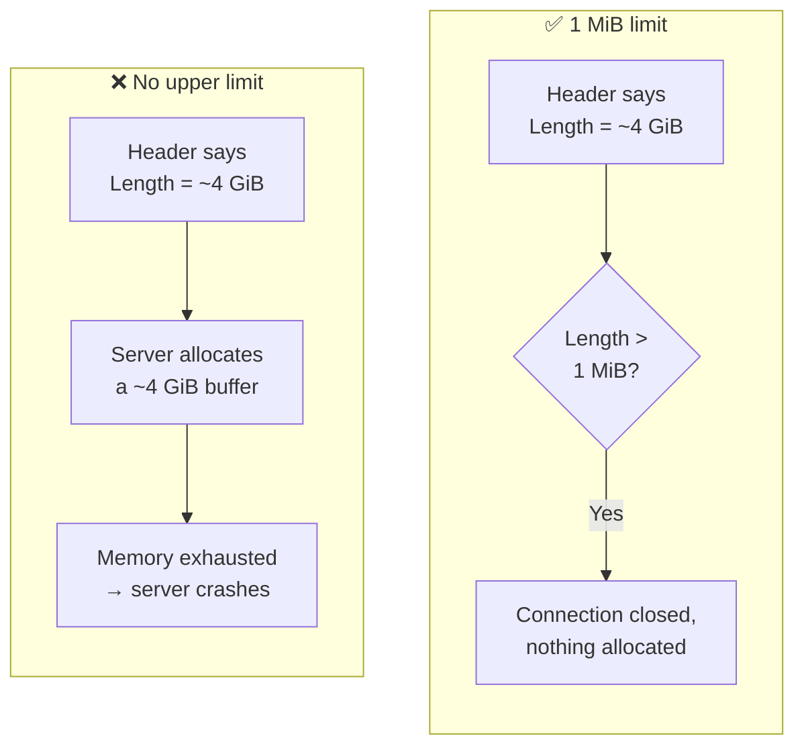
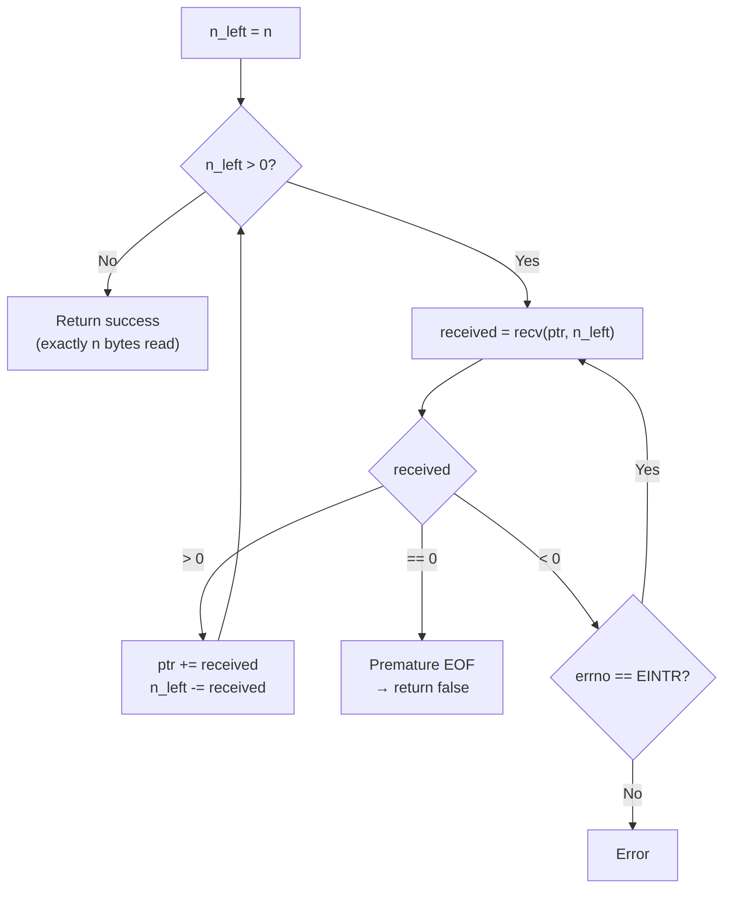

# 📨 Phase 2: Protocol Design & Framing

> **TL;DR - What does this phase cover?**
> - 🔢 Multi-byte integers go on the wire in **Big-Endian** (Network Byte Order).
> - 🛑 Every frame is capped at **1 MiB** so a bad `Length` can never exhaust memory.
> - 📥 **Server worker uses `recv_some`** (reads whatever is available); **Client uses `recv_exact`** (loops until it reads the exact number of bytes).
> - 🧱 Buffers are only allocated **after** `Length` is validated against `kMaxFrameSize`.

---

## 📐 Day 14 - Protocol Design Rationale & Framing

### 1. Why Big-Endian (Network Byte Order)?

- **Standardization:** Network protocols (TCP/IP, IP headers, DNS) universally adopt Big-Endian as the standard Network Byte Order.
- **Consistency across platforms:** Different CPU architectures store multi-byte integers in memory differently. x86/x64 are Little-Endian, while some processors (e.g., certain ARM configurations) are Big-Endian. By enforcing Big-Endian on the wire, any client and server running on completely different hardware architectures can communicate without misinterpreting integer values (like `Length`).

The same value, two byte orders:

```text
Value 10 as uint32_t

Big-Endian (on the wire):      00 00 00 0a    <- most significant byte first
Little-Endian (x86 memory):    0a 00 00 00    <- least significant byte first
```

A reader that assumed the wrong order would see `0a 00 00 00` as 167,772,160 instead of 10.

### 2. Why a Maximum Frame Size Limit of 1 MiB?

- **Denial-of-Service (DoS) prevention:** If there is no upper limit on the `Length` field, a malicious or buggy client could send a packet specifying a length of about 4 GiB (the `uint32_t` maximum). A naive server might try to allocate a massive buffer in RAM to read this payload, instantly exhausting server memory and crashing the server.
- **Resource predictability:** Restricting individual messages to 1 MiB (1,048,576 bytes = 2^20) ensures that memory allocations remain bounded, predictable, and safe.



### 3. Frame Structure (Current Implementation - v0)

The current protocol is simple: `[Length (4 bytes BE)] [Payload (N bytes)]`. The `Length` field only counts the payload (not including itself).

Example: Payload `"hello"` (5 bytes).
- Hex stream: `00 00 00 05 68 65 6c 6c 6f`
- Layout:

```text
 0             4                               9
┌─────────────┬───────────────────────────────┐
│ Length (4B) │         Payload (5B)          │
├─────────────┼───────────────────────────────┤
│ 00 00 00 05 │ 68 65 6c 6c 6f ("hello")      │
└─────────────┴───────────────────────────────┘
```

> 🧠 `Length` counts only the payload, which is why it is `5` and not `9`.

---

## 📥 Day 21 - `recv_some` vs `recv_exact` (Network I/O Stream Guarantees)

### 1. Functional Divergence

| | `recv_some` | `recv_exact` |
| :--- | :--- | :--- |
| **Behavior** | Thin wrapper around the POSIX `recv` system call. Returns whatever chunk is currently available in the TCP socket receive buffer (1 byte up to the requested capacity). | Enforces strict stream framing by looping over `recv` calls until exactly `n` bytes are accumulated in the destination buffer. |
| **Result** | Number of bytes read (`> 0`), EOF (`== 0`), or error (`< 0`). | Success once `n` bytes are read. Premature EOF (`received == 0`) is a failure state (`false`). |
| **Bookkeeping** | None needed. | Pointer arithmetic (`ptr += received`), remaining length (`n_left -= received`), and signal interruption (`EINTR`) handling. |
| **Use case** | General stream reading where message boundaries are not predetermined. **Used by the server worker (`handle_echo`).** | Protocol frame decoding, reading a fixed-size 4-byte header to learn the payload length, then an exact read of the payload bytes. **Used by the client (`AetherClient::recv_frame`).** |

### 2. How `recv_exact` Loops



### 3. Architectural Rationale

TCP delivers a byte stream, so the bytes of one frame can arrive split across several reads. Using `recv_some` directly for structured framing therefore leads to partial reads and protocol desynchronization. `recv_exact` guarantees that a read either returns exactly the requested number of bytes or fails, ensuring that upper-layer protocol parsers (`FrameDecoder`) only receive complete frames.

---

## 🧠 Day 23 — Buffer Management

### 1. Buffer Allocation Follows the Frame, Not the Socket

TCP gives no message boundaries, so the server cannot "read a message" in one call. Instead, buffer allocation is driven by the **frame structure**:

1. **Read the 4-byte header** into a fixed-size buffer. This size never depends on input — it is always 4 bytes.
2. **Validate `Length`** against `kMaxFrameSize` (1 MiB) *before* allocating anything. This is a comparison only — zero bytes allocated.
3. **Allocate exactly `Length` bytes** for the body, then `recv_some(Length)` into it.

| Step | Buffer size | Constraint |
| :--- | :--- | :--- |
| Read header | 4 bytes, fixed | independent of input |
| Validate `Length` | 0 bytes (compare only) | `Length <= kMaxFrameSize` (1 MiB) |
| Read body | exactly `Length` bytes | only reached after validation passes |

The key property: **no allocation happens before validation**. A header claiming ~4 GiB is rejected at step 2 with nothing allocated — the same DoS mitigation described in Day 14 §2, now expressed as an allocation-ordering rule rather than just a size check.

### 2. Why the Fixed Header Buffer Matters

The header read is the only place where the broker touches the socket without knowing the frame size. Keeping it at a fixed 4 bytes means:

- A malicious peer cannot influence the first allocation at all — it is a compile-time constant.
- The `Length` value is only trusted *after* it has been read in full by `recv_exact(4)`, so a partially-arrived header can never be misinterpreted as a smaller/larger frame.

### 3. Reflection

The through-line of Phase 2 is that **every buffer allocated is bounded by a value it has already validated**. The header buffer is bounded by the protocol (4 bytes). The body buffer is bounded by `Length`, which is bounded by `kMaxFrameSize`. Nothing the peer sends can cause an allocation larger than 1 MiB, and nothing is allocated before the bound is checked.