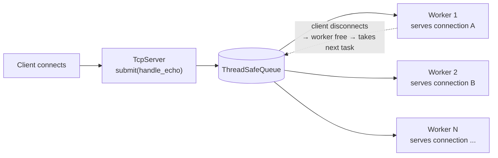

# 🧵 Phase 3: Concurrency & ThreadPool Design

> **TL;DR - What does this phase cover?**
> - 🧵 Concurrency = a fixed-size **blocking ThreadPool**: 1 worker per connection, so max concurrent clients = number of workers
> - 📬 Connections beyond the worker count wait as queued tasks in `ThreadSafeQueue`: already `accept()`-ed, but not served yet
> - 🧪 Worker exhaustion test: 4 workers + 5 persistent connections → the 5th is served only after one worker frees up
> - ⚠️ Core weakness: every connection pins a thread that mostly sits blocked in `recv` (the C10K problem)

---

## 🧵 Day 29 — Threading Model & Concurrency Design (Blocking ThreadPool)

### 1. Task-Queue ThreadPool Architecture

Concurrency is handled by a **Task-Queue ThreadPool**: a fixed number of worker threads, each running an infinite loop that pulls tasks from a thread-safe queue (`ThreadSafeQueue`).

- **Task submission:** when a client connects (`TcpServer`), a task that handles the connection lifecycle (`handle_echo`) is `submit`-ted to the `ThreadPool`.
- **Blocking execution:** the worker that picks up the task owns the **entire** connection lifetime — read a frame, process it, echo it back — in a loop until the client disconnects. The frame reading inside that loop uses the `recv_exact` approach from Phase 2 (Day 21) and the validation-before-allocation rule from Phase 2 (Day 23).

| Property | How it works | Architectural consequence |
| :--- | :--- | :--- |
| **Worker assignment** | 1 worker serves exactly 1 connection for its whole lifetime | A worker is occupied (blocked) for as long as the client keeps the connection open |
| **Concurrency limit** | Bounded by the number of workers in the pool | Max simultaneously *served* clients = number of workers |
| **Queue behavior** | Tasks beyond the worker count wait in `ThreadSafeQueue` | A waiting task is not served until some worker finishes its connection |

A side benefit worth noting: since only N connections are served at once, the memory held by frame bodies is also bounded. With one body buffer per active connection and the 1 MiB cap from Phase 2 (Day 14 §2), that is at most N × 1 MiB at any moment. This is a consequence of the design, not something that was measured.

### 2. Practical Test: Worker Exhaustion

To confirm the limit of the blocking model, the pool was run with a deliberately small number of workers:

1. **Fix the worker count** to a small value (`4` workers).
2. **Open persistent connections:** a client script opens **5 connections** at the same time and keeps them open (no immediate disconnect).
3. **Observed behavior:**

| Connection | Result |
| :--- | :--- |
| **1st – 4th** | Picked up immediately by the 4 workers, logged as connected and served normally |
| **5th** | Not served and not logged: every worker is occupied, so no thread is available to run its handler |
| **After one of the first 4 disconnects** | That worker returns to the pool, takes the 5th connection's task from the queue, and serves it |

**Where the 5th connection waits:** in `ThreadSafeQueue`, not in the OS listen backlog. `TcpServer::run()` loops `accept_one()` → `pool_.submit(...)`, and the accept loop runs on its own thread, independent of the workers. So the 5th connection is already `accept()`-ed and its `FileDescriptor` is held inside the queued task, but no worker has run `handle_echo` for it yet. That is why there is no "Client connected" log. From the client's side the connection looks established, and any bytes it sends just sit unread in the kernel socket receive buffer until a worker picks the task up.

### 3. Architectural Takeaway

- **Core weakness:** each connection pins one thread, and that thread spends most of its time blocked in `recv` waiting for data. Threads are expensive, so this model does not scale to a large number of mostly-idle clients (the classic C10K problem).
- **Why the limit is by design:** the pool size is a hard ceiling on concurrent clients, which is predictable, but one idle client can occupy a worker that other clients are waiting for.
- **Direction:** this motivates moving toward event-driven, non-blocking I/O multiplexing (e.g. `epoll`), where one thread watches many sockets and only works on those that are ready. This is a planned direction, not something implemented in this phase.

### 4. Cross-References

- **[Phase 2](phase-2.md), Day 14 §2** — `kMaxFrameSize` (1 MiB), which bounds per-connection memory.
- **[Phase 2](phase-2.md), Day 21 §1–§2** — `recv_exact`, used by the per-connection loop to read frames.
- **[Phase 2](phase-2.md), Day 23 §1** — validation-before-allocation, applied on every frame a worker reads.