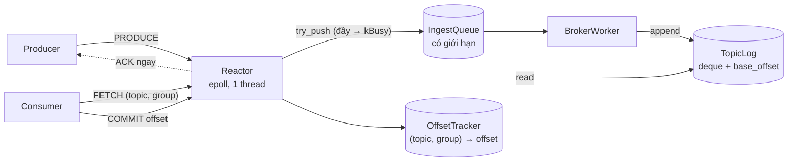

# ROADMAP — Aether Stream Layer: từ transport đến broker (Phase 4 → 7)

> File này đặt ở `docs/ROADMAP.md`. Nó là **kế hoạch**, không phải tài liệu mô tả repo, nên `tools/check_docs.sh` (Ngày 1) loại nó ra khỏi phần kiểm tra đường dẫn. Số ngày đánh lại từ 1 cho lộ trình này (Ngày 1–40) và **không nối** với số ngày trong `phase-1..3.md` / audit log, vì các số cũ đã lệch.

---

## Vì sao viết lại, và đích đến sau khi tinh chỉnh

Repo đã có sau 3 phase + audit: **transport sạch** (framing 4 byte big-endian, `FrameDecoder`, `ThreadPool` blocking, `ThreadSafeQueue`, `FileDescriptor` RAII, graceful shutdown, CI 4 cấu hình: Release/ASan/TSan/UBSan). Server hiện **chỉ echo**. Chưa có broker, topic, offset, ACK.

Ý tưởng gốc (Producer → Broker lưu memory → Consumer lấy theo offset, ACK ngay, không chờ đĩa) là ổn. Khi đối chiếu với code thật, tôi chỉnh 6 chỗ:

1. **Queue ≠ Log.** `std::queue` chỉ có `pop` (lấy là mất). Consumer đọc "theo offset", và nhiều consumer group đọc cùng một message, nên cần **log append-only** (`std::deque` + `base_offset`). `ThreadSafeQueue` vẫn dùng, nhưng đúng vai: **hàng đợi ingest** giữa mạng và broker, có giới hạn dung lượng.
2. **Offset tracker khóa theo `(topic, group)`**, không chỉ `group`, vì cùng một group đọc nhiều topic.
3. **"AP" phải nói cho thật.** Một node, trong RAM, không có partition mạng, nên không phải AP theo nghĩa CAP. Cái repo chứng minh được là: **ACK nhanh, quá tải vẫn trả lời (từ chối ghi chứ không chết), chấp nhận mất dữ liệu khi crash**. Phase 6 _đo_ đúng điều đó (loss-window + so với ACK-sau-fsync) thay vì chỉ tuyên bố.
4. **RAM vô hạn = chết.** Queue/log không giới hạn thì OOM, mất luôn tính sẵn sàng. Phải có giới hạn + chính sách mất dữ liệu rõ ràng (ingest đầy → `kBusy`; log đầy → bỏ message cũ nhất).
5. **Mô hình blocking không hợp với broker.** Một client rảnh ghim một worker; 8 client rảnh là server đứng (đợt audit đã ghi nhận và hoãn việc này tới phase sau). Vì vậy `epoll` được đưa lên **ngay sau khi broker chạy được** (Phase 5), không để cuối.
6. **Ngữ nghĩa giao hàng ghi ra từ đầu:** ACK = "đã nhận vào bộ nhớ broker", không phải "đã lưu". FETCH không tự commit nên consumer là **at-least-once**.

Kiến trúc đích:



**Không làm (non-goals):** ghi đĩa/WAL, replication, partition, rebalance consumer group, TLS/auth, nén. Đó là việc của các repo khác trong Aether (storage/CP). Ghi sẵn vào `docs/AP_TRADEOFFS.md` ở Phase 6 để không ai hỏi "sao không có".

---

## Luật chống lệch (đọc trước khi bắt đầu)

Lộ trình cũ lệch vì tài liệu và code chỉ được đối chiếu bằng mắt. Lần này:

1. **Máy kiểm, không phải mắt.** `tools/check_docs.sh` chạy trong CI: đường dẫn nhắc trong `.md` phải tồn tại, mọi file `tests/test_*.cpp` phải có trong `CMakeLists.txt`, link tương đối phải sống (⭐ thêm: số test trong README phải bằng số test thật). Script ngắn, chỉ là `grep`.
2. **Số liệu có một nguồn.** Hằng số: `config.hpp`. Số đo hiệu năng: `docs/BENCHMARKS.md`, mỗi dòng kèm **commit hash** + lệnh đã chạy. Đừng chép số sang README/SVG (nếu cần thì để `check_docs.sh` kiểm).
3. **Ví dụ lệnh có một nguồn.** Lệnh trong README là lệnh của `tests/e2e/quickstart.sh`, CI chạy nó. Ví dụ không chạy được thì CI đỏ.
4. **Doc cùng commit với code** (cùng PR). Không "để cuối phase viết doc".
5. **Ngày đồng bộ** = Ngày 10, 20, 30, 40. Việc: đối chiếu `ROADMAP.md` với repo, sửa phase sau nếu lệch, ghi vào bảng "Nhật ký lệch" cuối file. **Timebox ≤ 1 buổi.**
6. **Thấy thứ lệch giữa phase thì ghi một dòng vào mục **Nợ** ở cuối `docs/phase-N.md` của phase đang làm rồi đi tiếp.** Không dừng làm "dọn dẹp lớn". Chỉ xử lý ở ngày đồng bộ, hoặc ngay nếu nó chặn việc hôm nay.
7. **Doc lịch sử đóng băng:** `phase-1..3.md` thêm dòng `<!-- historical -->` ở đầu và để nguyên (script bỏ qua file có dòng này).

---

## Tổng quan

|Phase|Ngày|Chủ đề|Kết quả cuối (có thể dừng tại đây)|Tag|
|:-:|:-:|:--|:--|:-:|
|4|1–10|Broker core + Protocol v1 (trên mô hình blocking có sẵn)|`produce` → ACK ngay → `fetch` theo offset → `commit`; demo 2 terminal|`v0.4.0`|
|5|11–20|Event-driven I/O (`epoll`)|2000 client rảnh chỉ dùng vài thread; idle timeout; backpressure|`v0.5.0`|
|6|21–30|Đặc tính AP: giới hạn bộ nhớ, quá tải, đo đạc|Có số đo throughput/latency; chứng minh được "quá tải vẫn sống" và "crash thì mất gì"|`v0.6.0`|
|7|31–40|Đóng gói và phát hành|Flags, CLI streaming, shutdown gọn, README mới, clone mới chạy < 5 phút|`v1.0.0`|

Mỗi phase kết thúc bằng một tag chạy được, nên **dừng ở bất kỳ tag nào cũng ổn**: `v0.4.0` đã là broker chạy được (chỉ giới hạn ở số client đồng thời), `v0.5.0` giải quyết giới hạn đó, `v0.6.0` là bản có bằng chứng AP, Phase 7 chỉ là đóng gói. Phase khó nhất về kỹ thuật là 5 (`epoll`) và nặng nhất về kiên nhẫn là 6 (đo đạc). Trong Phase 6, lõi của việc chứng minh AP là Ngày 24, 25, 26; Ngày 27 là ⭐ có thể bỏ.

**Ký hiệu:** 🐧 luyện Linux · 🌿 Git · 🧪 test · 📝 docs · ⚠️ bẫy đã gặp hoặc rất dễ gặp · ⭐ tuỳ chọn.

**Lệnh dùng suốt lộ trình** (giữ như repo hiện tại):

```bash
cmake -B build && cmake --build build -j && ctest --test-dir build --output-on-failure
cmake -B build-tsan -DAETHER_SANITIZE=thread && cmake --build build-tsan -j && ctest --test-dir build-tsan --output-on-failure
```

---

# PHASE 4 — BROKER CORE + PROTOCOL v1 (Ngày 1–10)

**Mục tiêu phase:** biến server echo thành broker trong RAM: `PRODUCE` được ACK ngay, `FETCH` lấy message theo offset của consumer group, `COMMIT` ghi lại vị trí đã xử lý. Vẫn chạy trên mô hình blocking + `ThreadPool` có sẵn (đổi mô hình là việc của Phase 5). **Bạn học được:** thiết kế giao thức trước khi code, cấu trúc dữ liệu log + offset, hàng đợi có giới hạn, kiểm thử đa luồng bằng TSan. **Kết quả cuối phase:** demo 2 terminal (producer gửi 3 message, consumer lấy đúng thứ tự, commit rồi fetch lại thì rỗng), CI xanh, tag `v0.4.0`.

---

### Ngày 1 — Khóa đồng bộ: `check_docs.sh` trước khi viết dòng code nào

**Hôm nay làm gì:** đưa roadmap vào repo và dựng bộ kiểm tra tài liệu tự động. **Mục tiêu:** CI đỏ khi tài liệu nói dối code. **Tại sao:** đây là nguyên nhân gốc khiến lần trước phải dọn dẹp 11 ngày. Đầu tư 1 buổi ở đây rẻ hơn rất nhiều so với dọn dẹp cuối phase.

- [x] 🌿 Nhánh `chore/doc-drift-check`; chép roadmap vào `plan/ROADMAP.vi.md` (không phải `docs/`, vì `docs/` là tài liệu tiếng Anh về repo); thêm dòng `<!-- historical -->` vào đầu `docs/phase-1.md`, `phase-2.md`, `phase-3.md`; tạo `docs/phase-4.md` với mục **Quyết định** ghi lý do roadmap ở `plan/`
- [x] Viết `tools/check_docs.sh` (bash, `set -euo pipefail`, khoảng 40 dòng) với 3 luật bắt buộc và 1 luật tuỳ chọn:
    - (1) mọi token dạng `(src|include|tests|tools|docs|notes)/<tên>.<đuôi>` trong `*.md` phải là file có thật; bỏ qua `plan/`, file có `<!-- historical -->`, và mọi dòng chứa chữ `PLANNED`
    - (2) mọi `tests/test_*.cpp` phải xuất hiện trong `CMakeLists.txt` (⚠️ danh sách test đang liệt kê tay: quên thêm file thì test không chạy mà không ai biết)
    - (3) mọi link tương đối `](đường/dẫn)` trong `.md` phải trỏ tới file có thật
    - (4) ⭐ tuỳ chọn, làm sau cũng được: mọi chuỗi kiểu "`N unit tests`" / "`N cases`" trong `README.md` phải bằng số test thật (đếm từ `./build/aether_tests --gtest_list_tests`, dòng thụt 2 dấu cách = 1 test)
- [x] 🐧 Chạy lần đầu **có thể đỏ**, đó là kết quả đúng. Lệch đã biết khi đọc repo: hai workflow CI (`build.yml`, `lint.yml`) còn kích hoạt trên nhánh `audit/clean` (nhánh dọn dẹp cũ; nếu nhánh đó không còn thì xóa chữ `audit/clean` khỏi dòng `branches:`); README có thể còn link tới các file đã xóa (`DECISIONS.md`, `inventory.md`, `TODO.md`) → luật (1)/(3) sẽ báo, xóa hoặc sửa link
- [x] Sửa đúng các lỗi script báo. ⚠️ Timebox: thấy thứ khác lệch thì ghi một dòng vào mục **Nợ** của `docs/phase-4.md`, không sửa hôm nay
- [x] Thêm bước `bash tools/check_docs.sh` vào job Release của `build.yml` (sau bước build)
- [x] 🌿 Commit: `ci: add documentation drift checks`

**Xong khi:** script đỏ trên bản cũ, xanh sau khi sửa, và CI chạy nó.

---

### Ngày 2 — Protocol v1: viết đặc tả trước, code sau

**Hôm nay làm gì:** viết `docs/PROTOCOL.md` v1 và ghi quyết định vào mục **Quyết định** của `docs/phase-4.md` (mỗi phase có mục này, mỗi quyết định 2–3 dòng: chọn gì, vì sao). **Mục tiêu:** mọi ngữ nghĩa mơ hồ được chốt bằng chữ trước khi có code. **Tại sao:** phần "planned v1" cũ chỉ có `Command | TopicLength | Topic | Payload`; thiếu consumer group, offset, mã trạng thái. Để tới lúc code mới nghĩ sẽ sinh ra đúng loại lệch mà bạn vừa dọn.

- [ ] Giữ nguyên tầng khung v0 (`Length | Payload`, trần 1 MiB). v1 là cấu trúc **bên trong** `Payload`, nên `frame.cpp`, `FrameDecoder` và `aether_frame_torture` không phải sửa
    
- [ ] Request payload: `Command(1) | TopicLength(2 BE) | Topic | Body`. Response payload: `Status(1) | Body`. Response trả **đúng thứ tự request** trên cùng connection (cho phép pipelining sau này)
    
- [ ] Bảng lệnh (viết vào PROTOCOL.md):
    
    |Lệnh|Mã|Body request|Body response|
    |:--|:-:|:--|:--|
    |`PING`|4|rỗng (topic rỗng được phép)|rỗng|
    |`PRODUCE`|1|bytes của message|rỗng. `kOk` = "đã nhận vào bộ nhớ broker"|
    |`FETCH`|2|`GroupLength(2 BE) \| Group \| MaxMessages(4 BE)`|`FirstOffset(8 BE) \| Count(4 BE) \| Count × (MsgLength(4 BE) \| bytes)`|
    |`COMMIT`|3|`GroupLength(2 BE) \| Group \| Offset(8 BE)`|rỗng|
    
    Mã `Status`: `kOk=0`, `kBusy=1` (hàng đợi ingest đầy), `kBadRequest=2` (sai định dạng, lệnh lạ, tên sai, quá cỡ)
    
- [ ] **Ngữ nghĩa phải viết ra** (mỗi cái 1 dòng): (a) offset của topic bắt đầu từ 0, +1 mỗi message; (b) ⚠️ `COMMIT(k)` nghĩa là "đã xử lý xong 0..k-1, lần FETCH sau bắt đầu từ k" (nhầm off-by-one ở đây là lỗi kinh điển); (c) FETCH đọc từ offset đã commit của `(topic, group)` và **không tự commit** → consumer at-least-once; (d) FETCH topic chưa tồn tại trả `Count=0`, không phải lỗi (consumer có thể khởi động trước producer); (e) COMMIT chỉ được tiến, không lùi, và không vượt `next_offset`; (f) tên topic/group khớp `[A-Za-z0-9._-]{1,64}` (chống log injection, và cho phép dùng `/` làm dấu ngăn khi ghép khóa); (g) `MaxMessages` bị kẹp ở `kMaxFetchMessages = 1000`, giá trị 0 là `kBadRequest`
    
- [ ] ⚠️ **Cỡ message tối đa không phải 1 MiB.** Response của FETCH có thêm 17 byte (`Status 1 + FirstOffset 8 + Count 4 + MsgLength 4`) và request của PRODUCE có thêm `3 + len(topic)` byte, đều phải nằm trong 1 MiB của khung. Chốt `kMaxMessageSize = kMaxFrameSize - 128` (header lớn nhất hiện nay là `3 + 64 = 67` byte, nên 128 là đủ và còn dư) và ghi vào `config.hpp`/`frame.hpp` kèm `static_assert` (cỡ message + 17 ≤ khung, và cỡ message + 3 + 64 ≤ khung; sau này header phình ra thì `static_assert` sẽ báo ngay). Ghi cả giới hạn mềm của broker: `kMaxTopics = 64`, `kMaxGroups = 1024`
    
- [ ] Viết ví dụ hex tính tay từng byte (Ngày 3 sẽ dùng làm test vector): `PING` = `00 00 00 03 04 00 00`, response `00 00 00 01 00`; `PRODUCE` topic `t` message `hi` = `00 00 00 06 01 00 01 74 68 69`, response `00 00 00 01 00`
    
- [ ] 📝 Ghi 3 quyết định vào mục **Quyết định** của `docs/phase-4.md`: v1 nằm trong Payload; ACK = "accepted, not stored"; offset commit = offset kế tiếp. Cập nhật mục "Future Work" trong PROTOCOL.md thành "v1 (PLANNED, đang làm)"
    
- [ ] 🌿 Commit: `docs: protocol v1 specification`
    

**Xong khi:** bạn giải thích được vì sao message lớn nhất không phải 1 MiB đúng, và `COMMIT(3)` nghĩa là gì.

---

### Ngày 3 — Codec: `message.hpp`

**Hôm nay làm gì:** viết bộ mã hóa/giải mã request và response. **Mục tiêu:** dữ liệu rác từ mạng không bao giờ làm crash hay ném exception. **Tại sao:** đây là chỗ đầu tiên code của bạn tin vào cấu trúc do người lạ gửi tới; mọi `length` đều phải được kiểm tra trước khi dùng.

- [ ] `include/message.hpp` + `src/message.cpp` (đã được `file(GLOB CONFIGURE_DEPENDS)` nhặt, không cần sửa CMake): `enum class Command : uint8_t`, `enum class StatusCode : uint8_t`, `struct Request { Command cmd; std::string topic; std::vector<uint8_t> body; }`
- [ ] `std::optional<Request> decode_request(std::span<const uint8_t>)`, `std::vector<uint8_t> encode_response(StatusCode, std::span<const uint8_t> body)`, và phía client `encode_request`, `decode_response`
- [ ] Viết một `BodyReader` nhỏ: con trỏ có kiểm biên (`read_u16/u32/u64/bytes` trả `bool`). Cả FETCH lẫn COMMIT dùng chung để khỏi lặp lại kiểm biên. ⚠️ Số 64-bit big-endian: không có `htonll` chuẩn, dùng `htobe64` / `be64toh` trong `<endian.h>`
- [ ] ⚠️ Quy tắc: **dữ liệu từ mạng → trả `nullopt`/`kBadRequest`, không ném exception** (khác `encode_frame` ném khi payload quá lớn, vì phía đó là lỗi của chính ta)
- [ ] 🧪 `tests/test_message.cpp`: round-trip từng lệnh; các vector hex của Ngày 2; **cắt cụt**: lấy một payload hợp lệ rồi cắt ở mọi độ dài 0..n-1, tất cả phải trả `nullopt`; `TopicLength` lớn hơn phần còn lại; ký tự cấm trong tên; tên 65 ký tự; "fuzz-lite": 100.000 chuỗi byte ngẫu nhiên (seed cố định) đưa vào `decode_request`, chạy dưới ASan không được crash
- [ ] Thêm `tests/test_message.cpp` vào `add_executable(aether_tests ...)` (luật 2 của `check_docs.sh` sẽ nhắc nếu quên)
- [ ] 🌿 Commit: `feat: add protocol v1 message codec`

**Xong khi:** ASan xanh với fuzz-lite; bạn giải thích được vì sao decode không ném exception.

---

### Ngày 4 — `TopicLog`: log append-only theo offset

**Hôm nay làm gì:** viết cấu trúc lưu message của một topic. **Mục tiêu:** `append` trả offset, `read(from, ...)` trả message theo offset. **Tại sao:** nhiều consumer group đọc cùng một message ở các vị trí khác nhau, nên không thể dùng `std::queue` (lấy ra là mất). Đây là điểm khác chính so với ý tưởng gốc.

- [ ] `include/topic_log.hpp` + `src/topic_log.cpp`: `std::deque<std::vector<uint8_t>>` + `uint64_t base_offset_` (luôn 0 cho tới Phase 6; có sẵn để API không đổi) + `std::mutex`
- [ ] API: `uint64_t append(std::vector<uint8_t>)` trả offset; `ReadResult read(uint64_t from, size_t max_msgs, size_t max_bytes)` trả `{first_offset, messages}`; `next_offset()`, `base_offset()`
- [ ] Quy tắc `read` (chốt bằng test): `from < base` thì bắt đầu từ `base`; `from >= next` thì rỗng; dừng khi thêm message sẽ vượt `max_bytes`, **nhưng luôn trả ít nhất 1 message nếu có** (nếu không, một message lớn sẽ làm consumer kẹt mãi)
- [ ] ⚠️ `read` copy payload khi đang giữ mutex. Đơn giản và đúng; chỉ tối ưu ở Phase 6 nếu số đo bảo phải làm
- [ ] 🧪 `tests/test_topic_log.cpp`: offset 0..n-1 liên tục; đọc nhiều cửa sổ; đọc ở cuối → rỗng; `max_bytes` cắt đúng và vẫn trả 1; **đa luồng**: 4 thread append 5000 message mỗi thread (nhúng `t<id>_<seq>` vào payload) trong khi 1 thread đọc liên tục; sau join: đúng 20.000 message, offset không trùng không thiếu, `seq` của từng thread tăng dần
- [ ] 🧪 Kiểm chứng test có tác dụng: tạm bỏ mutex, chạy TSan, phải thấy báo data race; trả mutex về rồi chạy lại xanh
- [ ] 🌿 Commit: `feat: add in-memory topic log with offsets`

**Xong khi:** TSan xanh; bạn giải thích được vì sao `TopicLog` là `deque` có offset chứ không phải `std::queue`.

---

### Ngày 5 — `OffsetTracker`

**Hôm nay làm gì:** lưu vị trí đã commit của từng `(topic, group)`. **Mục tiêu:** `get`/`commit` an toàn đa luồng, chỉ tiến không lùi. **Tại sao:** nhờ nó, consumer khởi động lại là đọc tiếp đúng chỗ, không đọc lại từ đầu.

- [ ] `include/offset_tracker.hpp`: `std::unordered_map<std::string, uint64_t>` + `std::mutex`. Khóa = `topic + "/" + group` (tên đã được kiểm charset nên dấu `/` không thể xuất hiện trong tên, không có đụng khóa)
- [ ] `uint64_t get(topic, group) const` (mặc định 0); `CommitResult commit(topic, group, offset)`: từ chối lùi, từ chối khi sẽ vượt `kMaxGroups` khóa. Việc "không vượt `next_offset`" do `Broker` kiểm (Ngày 7), vì tracker không biết log
- [ ] ⚠️ Off-by-one, viết thành test cụ thể: log có 5 message; FETCH 3 → offset 0,1,2; `commit(3)`; FETCH → offset 3,4
- [ ] 🧪 `tests/test_offset_tracker.cpp`: mặc định 0; tiến; từ chối lùi; hai group độc lập; hai topic độc lập; chạm giới hạn khóa; 8 thread commit tăng dần → kết quả cuối là max
- [ ] 📝 `docs/phase-4.md` (Quyết định): tracker **không** lưu xuống đĩa (restart broker là mất, thống nhất với hướng AP in-memory)
- [ ] 🌿 Commit: `feat: add consumer group offset tracker`

**Xong khi:** test xanh; bạn giải thích được vì sao khóa gồm cả topic.

---

### Ngày 6 — Hàng đợi ingest có giới hạn

**Hôm nay làm gì:** thêm dung lượng tối đa và `try_push` vào `ThreadSafeQueue`. **Mục tiêu:** khi đầy thì **từ chối** thay vì phình bộ nhớ. **Tại sao:** AP nghĩa là "vẫn trả lời khi quá tải". Hàng đợi vô hạn sẽ OOM và chết hẳn; hàng đợi có giới hạn + `kBusy` thì mất một phần ghi nhưng server vẫn sống.

- [ ] Đọc lại `include/thread_safe_queue.hpp`: hiện `push` luôn thành công, không có giới hạn
- [ ] Thêm `explicit ThreadSafeQueue(size_t capacity = 0)` (0 = không giới hạn → hành vi cũ, 6 test cũ không được đổi) và `bool try_push(T& item)`; thêm `size() const`
- [ ] ⚠️ `try_push` nhận `T&` và chỉ `std::move` **sau khi** chắc chắn nhận. Nếu nhận theo giá trị hoặc move trước khi kiểm, message bị từ chối đã bị "ăn mất" và không thể trả `kBusy` kèm dữ liệu còn nguyên. Chỉ `notify_one()` khi push thành công
- [ ] Quy tắc: queue đã `close()` thì `try_push` trả `false`
- [ ] 🧪 Thêm test: đầy → `false`, `pop` một cái → `true`; sau `close()` → `false`; **MPMC có giới hạn**: 4 producer `try_push` 10.000 mỗi thread (không thử lại), 2 consumer; kiểm `accepted + rejected == 40000` và `popped == accepted`. Chạy dưới TSan
- [ ] 🌿 Commit: `feat: add bounded mode and try_push to ThreadSafeQueue`

**Xong khi:** 6 test cũ vẫn xanh cùng các test mới; bạn giải thích được vì sao `try_push` không nhận theo giá trị.

---

### Ngày 7 — `Broker` và `BrokerWorker`

**Hôm nay làm gì:** ráp queue + log + tracker thành `Broker`. **Mục tiêu:** `produce` trả ngay (`kOk`/`kBusy`/`kBadRequest`), một thread nền chuyển message từ queue vào log. **Tại sao:** đây là "Broker nhét vào Queue và ACK ngay" của ý tưởng gốc, nay có bàn giao rõ ràng giữa luồng mạng và luồng xử lý.

- [ ] `include/broker.hpp` + `src/broker.cpp`. Constructor **không** tự chạy thread; có `start()` và `stop()` riêng. (Lý do: test quá tải ở Ngày 25 cần broker không có worker để hàng đợi đầy một cách xác định.)
- [ ] `StatusCode produce(topic, payload)`: kiểm tên + `kMaxMessageSize` + giới hạn topic (giới hạn **mềm**, vượt vài cái do race là chấp nhận được) → `ingest_.try_push` → `kOk` hoặc `kBusy`. `FetchResult fetch(topic, group, max_msgs)`; `StatusCode commit(topic, group, offset)` (kiểm `offset ≤ next_offset` của log rồi gọi tracker)
- [ ] Worker là `std::jthread` chạy `while (auto m = ingest_.pop()) { log_for(m->topic).append(...); }`. `pop()` chỉ trả `nullopt` khi queue đã đóng **và** rỗng, nên `stop()` = `close()` + `join()` tự động xả hết message đã ACK. Không cần `pop_for` ở đây (ghi nhận: sẽ xóa ở Ngày 19 vì đợt audit đã ghi "không dùng sau 2 phase thì xem xét xóa")
- [ ] Bảng topic: `std::mutex` + `std::unordered_map<std::string, std::unique_ptr<TopicLog>>` (`unique_ptr` để địa chỉ không đổi khi map rehash). Topic tạo lười ở worker
- [ ] ⚠️ Thứ tự `stop()` và hủy: worker dùng log nên phải join trước khi hủy bảng topic
- [ ] 🧪 `tests/test_broker.cpp`: **không** `start()`: `capacity` lần `produce` đầu `kOk`, các lần sau `kBusy` (xác định, không phụ thuộc thời gian); `start()` rồi produce 1000 → đợi (vòng lặp có hạn 2 giây, không `sleep` cố định) tới khi `next_offset == 1000`, thứ tự đúng; kịch bản fetch/commit/fetch của Ngày 5; `stop()` khi queue còn message → không mất message nào đã ACK; chạy TSan
- [ ] 🌿 Commit: `feat: add broker with async ingest worker`

**Xong khi:** bạn kể lại được hành trình một message (produce → ACK → queue → worker → log → fetch) trong 1 phút không nhìn file.

---

### Ngày 8 — Nối vào mạng (vẫn blocking)

**Hôm nay làm gì:** thay `handle_echo` bằng `handle_session` đọc lệnh v1 và gọi `Broker`. **Mục tiêu:** `nc` + `xxd` chơi được với server như một broker. **Tại sao:** thấy hệ thống sống sớm; phần mạng không đổi nên rủi ro thấp.

- [ ] Trong `session.cpp`: `handle_session(std::shared_ptr<FileDescriptor>, Broker&)`: `recv_some` → `FrameDecoder` → `decode_request` → dispatch → `encode_response` → `encode_frame` → `send_all`. `PING`/`PRODUCE`/`FETCH`/`COMMIT` gọi `Broker` và trả response **ngay**
- [ ] `TcpServer` sở hữu `Broker`; ⚠️ khai báo `Broker broker_` **trước** `ThreadPool pool_` (member bị hủy theo thứ tự ngược với khai báo; worker của pool còn đang dùng broker lúc pool join)
- [ ] ⚠️ Request sai định dạng ở tầng v1 → trả `kBadRequest` và **giữ** connection (khung vẫn hợp lệ). Chỉ lỗi tầng khung (header quá 1 MiB) mới đóng connection như hiện nay
- [ ] ⚠️ **Đừng log từng message ở mức Info.** `handle_echo` cũ log mỗi frame (`Received frame, size = ...`); với broker, mỗi dòng log tốn `ostringstream` + `localtime_r` + khóa mutex + ghi `stderr`, và sẽ thành nút cổ chai ở Phase 6. Chỉ log: connect/disconnect, lỗi
- [ ] 🐧 Thử tay: `printf '\x00\x00\x00\x03\x04\x00\x00' | nc -q1 127.0.0.1 8080 | xxd` phải ra `00 00 00 01 00`. Gửi vector `PRODUCE` của Ngày 2 theo cách tương tự
- [ ] Cập nhật `aether_frame_torture`: scenario "fragmentation" và "coalescing" hiện kiểm tra echo giống hệt; đổi thành gửi `PING` (chia từng byte / dồn 3 cái vào 1 `send`) và kiểm response `kOk` (1 hoặc 3 cái)
- [ ] 🌿 Commit: `feat: serve broker commands instead of echo`

**Xong khi:** `nc` + `xxd` nhận đúng `kOk` cho `PING` và `PRODUCE`; torture test vẫn PASS.

---

### Ngày 9 — CLI + kịch bản e2e làm nguồn sự thật cho README

**Hôm nay làm gì:** `aether_cli` có lệnh con, và có một script e2e mà CI chạy. **Mục tiêu:** demo 2 terminal chạy được, và README chỉ chứa lệnh đã được CI chạy. **Tại sao:** README là thứ lệch nhanh nhất; buộc nó vào một script chạy được.

- [ ] `aether_cli [--host H] [--port P] <lệnh>`: `ping`, `produce <topic> <msg>`, `fetch <topic> <group> [max]`, `commit <topic> <group> <offset>`. Host mặc định `127.0.0.1`, port mặc định `config::kDefaultPort`. Thêm `AetherClient::call(...)` gói request + đọc response
- [ ] `aether_server` nhận `argv[1]` là port (tạm thời, flags đầy đủ ở Ngày 31) để e2e chạy cổng tùy ý
- [ ] `tests/e2e/quickstart.sh <build-dir>`: chọn cổng ngẫu nhiên (`$((20000 + RANDOM % 20000))`), chạy server nền với `trap 'kill $SRV' EXIT`, đợi cổng mở bằng vòng `nc -z` tối đa 5 giây (không `sleep` mù), rồi chạy đúng các lệnh của README: produce 3 message → fetch (3 message đúng thứ tự) → commit 3 → fetch (rỗng) → produce thêm 1 → fetch (message mới). So bằng `diff <(...) <(printf ...)`; lệch thì thoát mã ≠ 0
- [ ] 🐧 Nếu chạy tay thấy "Address already in use": `ss -ltnp | grep 8080`; script dùng cổng ngẫu nhiên nên CI không đụng nhau
- [ ] Thêm bước chạy `tests/e2e/quickstart.sh build` vào CI (job Release)
- [ ] 🌿 Commit: `test: add e2e quickstart script and broker CLI`

**Xong khi:** chạy script xanh; bạn chạy được demo bằng tay ở 2 terminal.

---

### Ngày 10 — Đồng bộ, review, tag `v0.4.0`

**Hôm nay làm gì:** kiểm tra, ghi lại phase, đối chiếu roadmap, gắn tag. **Mục tiêu:** repo ở trạng thái "có thể dừng tại đây". **Tại sao:** đây là ngày đồng bộ; làm đủ nhưng gọn (≤ 1 buổi). Phần còn lại của ngày là **buffer**: việc dở ở Ngày 1–9 làm ở đây, đừng nén các ngày trước.

- [ ] 3 build sanitizer (ASan, TSan, UBSan) + `ctest` + e2e đều xanh
- [ ] 📝 `docs/phase-4.md` (≤ 80 dòng): sơ đồ hành trình một message (Mermaid), 3 quyết định chính, và **những gì chưa có** (epoll, giới hạn log). Chỉ nêu số liệu nếu kèm cách đo
- [ ] 📝 README: cập nhật "Where the project stands", bảng roadmap, quick start (trỏ tới `tests/e2e/quickstart.sh`); `check_docs.sh` xanh
- [ ] **Đồng bộ roadmap:** đọc Phase 5 bên dưới, đối chiếu với tên file/hàm thật vừa tạo; sửa `ROADMAP.md` nếu lệch; ghi vào bảng "Nhật ký lệch"
- [ ] 🌿 Merge, `git tag -a v0.4.0 -m "phase 4: broker core"`, `git push --tags`

**Xong khi:** CI xanh trên `main`, tag `v0.4.0` có trên GitHub.

---

## TỔNG KẾT PHASE 4

**Sau phase 4 bạn có:** một broker in-memory chạy được từ đầu đến cuối: giao thức v1 có đặc tả và test vector, `TopicLog` + `OffsetTracker` + hàng đợi ingest có giới hạn, CLI, e2e script, và bộ kiểm tra tài liệu trong CI.

- [ ] Demo 2 terminal chạy được (produce 3 → fetch 3 → commit → fetch rỗng)
- [ ] `check_docs.sh` + e2e nằm trong CI
- [ ] Tag `v0.4.0`

**Tự kiểm tra (trả lời bằng lời của mình):**

1. Vì sao `TopicLog` là `deque` + offset mà không phải `std::queue`?
2. `PRODUCE` trả `kOk` nghĩa là gì? Kể 2 tình huống một message đã được ACK vẫn có thể biến mất.
3. `COMMIT(3)` nghĩa là gì, và vì sao FETCH không tự commit?
4. Vì sao hàng đợi ingest có giới hạn tốt hơn không giới hạn, với một hệ thống "ưu tiên sẵn sàng"?

**Nếu chưa trả lời được câu nào, bù ngay:**

- Câu 1 → đọc lại phần "Queue ≠ Log" ở đầu file này, rồi tự viết 5 câu (15 phút)
- Câu 2 → viết 3 dòng vào mục **Nợ** của `docs/phase-4.md`: ACK nghĩa gì; mất khi broker crash; mất khi worker chưa kịp chuyển từ queue sang log (15 phút)
- Câu 3 → chạy lại test ví dụ Ngày 5 và vẽ ra giấy offset 0..4 (10 phút)
- Câu 4 → chạy thử bỏ giới hạn trong test Ngày 7, so kích thước hàng đợi khi producer nhanh hơn worker (20 phút)

**Quy tắc sang phase 5:** trả lời được ít nhất 3/4 câu. Câu còn lại ghi vào mục **Nợ** của `docs/phase-4.md` và bù ở Ngày 19.

---

# PHASE 5 — EVENT-DRIVEN I/O với `epoll` (Ngày 11–20)

**Mục tiêu phase:** thay mô hình "1 connection ghim 1 worker" bằng một vòng lặp `epoll` một thread. **Bạn học được:** non-blocking socket, `epoll` level-triggered, bộ đệm đọc/ghi theo từng connection, backpressure, idle timeout, vì sao đóng fd giữa vòng lặp sự kiện nguy hiểm. **Kết quả cuối phase:** 2000 connection rảnh chỉ tốn vài thread; client không bao giờ đọc response không làm phình bộ nhớ server; tag `v0.5.0`.

---

### Ngày 11 — Thấy vấn đề tận mắt, rồi thử `epoll` ngoài repo

**Hôm nay làm gì:** tái hiện giới hạn của mô hình blocking, rồi viết một chương trình `epoll` đồ chơi **ngoài repo** để học. **Mục tiêu:** hiểu _vì sao_ phải đổi, và nắm hành vi level-triggered. **Tại sao:** với broker, vấn đề nặng hơn echo: một consumer rảnh cũng chiếm một worker.

- [ ] 🐧 Chạy server Phase 4, mở 8 connection rảnh: `for i in $(seq 8); do nc 127.0.0.1 8080 & done`, rồi `aether_cli ping`: lệnh treo (9 client > 8 worker). `kill %1 %2 ...` giải phóng chúng thì `ping` chạy tiếp
- [ ] 🐧 Đọc `man 7 epoll`, `man 2 epoll_ctl`, `man 2 epoll_wait`, `man 2 accept4`
- [ ] Viết `~/scratch/epoll_echo.cpp` (**không commit**, khoảng 60 dòng): `socket` non-blocking, `epoll_create1`, accept, echo. Thử 3 hiện tượng và ghi lại bằng lời mình: (1) không đọc hết dữ liệu thì `epoll_wait` cứ trả về tiếp (level-triggered); (2) đăng ký `EPOLLOUT` vĩnh viễn thì vòng lặp quay 100% CPU vì socket gần như luôn "ghi được"; (3) `recv` trả 0 = peer đóng
- [ ] 📝 `docs/phase-5.md` (Quyết định; tạo file ngay hôm nay): chọn **level-triggered** (đơn giản, khó mất sự kiện), **một reactor thread**, xử lý lệnh broker **ngay trong reactor** (thao tác trong RAM, O(1) hoặc O(max_msgs)); riêng `PRODUCE` vẫn qua hàng đợi ingest. Ghi lý do không chọn edge-triggered
- [ ] 🌿 Commit: `docs: record event loop design decisions`

**Xong khi:** bạn giải thích được vì sao chỉ đăng ký `EPOLLOUT` khi còn dữ liệu chờ gửi.

---

### Ngày 12 — Bọc `epoll` bằng RAII

**Hôm nay làm gì:** viết lớp `Epoll` mỏng. **Mục tiêu:** không còn `epoll_ctl` thô rải rác. **Tại sao:** cùng lý do bạn đã làm `FileDescriptor`: tài nguyên có chủ sở hữu rõ ràng.

- [ ] `include/epoll.hpp` + `src/epoll.cpp`: giữ một `FileDescriptor` (tạo bằng `epoll_create1(EPOLL_CLOEXEC)`); `bool add(int fd, uint32_t events, uint64_t id)`, `bool mod(...)`, `bool del(int fd)`, `int wait(std::vector<epoll_event>& out, int timeout_ms)`
- [ ] `add/mod/del` trả `bool` thay vì ném (lỗi của một connection, ví dụ `ENOMEM`, không được làm sập cả server); `wait` gặp `EINTR` thì trả 0 sự kiện
- [ ] ⚠️ Dùng `epoll_event.data.u64` chứa **id connection** (số tăng dần), không chứa con trỏ hay fd thô. Lý do sẽ rõ ở Ngày 16
- [ ] Thêm `bool set_nonblocking(int fd)` vào `net_io` (`fcntl` `F_GETFL`/`F_SETFL`)
- [ ] 🧪 `tests/test_epoll.cpp` bằng `pipe2`/`socketpair`: chưa ghi → `wait` timeout trả 0; ghi 1 byte → `EPOLLIN`; `del` rồi ghi tiếp → không có sự kiện; đóng đầu kia → `EPOLLHUP`/`EPOLLIN` với `recv==0`
- [ ] 🌿 Commit: `feat: add RAII epoll wrapper`

**Xong khi:** test xanh dưới ASan và TSan; bạn giải thích được vì sao hàm `add` không ném.

---

### Ngày 13 — Accept không chặn

**Hôm nay làm gì:** listen socket non-blocking, accept theo vòng. **Mục tiêu:** một sự kiện `EPOLLIN` trên listen fd xử lý hết các connection đang chờ. **Tại sao:** nhiều connection đến cùng lúc; mỗi lần `epoll_wait` chỉ accept một cái thì chậm vô ích.

- [ ] Listen socket: `socket(AF_INET, SOCK_STREAM | SOCK_NONBLOCK | SOCK_CLOEXEC, 0)`. Accept bằng `accept4(..., SOCK_NONBLOCK | SOCK_CLOEXEC)` lặp tới khi `EAGAIN`; `EINTR`/`ECONNABORTED` thì thử tiếp
- [ ] `setsockopt(TCP_NODELAY)` trên socket vừa accept (request-response nhỏ, không muốn Nagle chờ). Số đo tác dụng ở Ngày 23
- [ ] ⚠️ **`EMFILE`** (hết fd): vòng `sleep 100ms` của code cũ sẽ đóng băng toàn bộ reactor. Dùng thủ thuật fd dự phòng: giữ sẵn 1 fd mở `/dev/null`; khi `EMFILE` → đóng fd dự phòng, `accept` rồi đóng ngay connection đó (để kernel dọn hàng đợi), mở lại fd dự phòng; log mức Warn (giới hạn tần suất log)
- [ ] 🧪 Kiểm tra bằng test dùng `setrlimit(RLIMIT_NOFILE)` thấp trong một tiến trình con (hoặc test thủ công bằng `ulimit -n 32`), chứng minh server vẫn phản hồi sau khi bị `EMFILE`
- [ ] 🌿 Commit: `feat: non-blocking accept loop with EMFILE handling`

**Xong khi:** mở 50 connection cùng lúc, tất cả được accept trong một vòng lặp, và server không treo khi hết fd.

---

### Ngày 14 — `Connection`: trạng thái và đường đọc

**Hôm nay làm gì:** gói trạng thái từng connection (bộ giải khung, bộ đệm ra, mốc thời gian) và xử lý đọc. **Mục tiêu:** đọc dữ liệu rời rạc, chia nhỏ hay dính nhau, mà không bao giờ chặn. **Tại sao:** `FrameDecoder` của bạn vốn đã tăng dần nên dùng lại được nguyên vẹn; đó là phần thưởng của việc tách tầng khung ra từ Phase 2.

- [ ] `include/connection.hpp` + `src/connection.cpp`: `FileDescriptor fd_`, `FrameDecoder decoder_`, `std::vector<uint8_t> out_`, `size_t out_off_`, `time_point last_activity_`, `uint64_t id_`
- [ ] `on_readable(Broker&)`: lặp `::recv` (non-blocking) tới khi `EAGAIN` **hoặc** hết ngân sách mỗi lượt (ví dụ 64 KiB, để một client ồn ào không độc chiếm vòng lặp); `recv==0` → đánh dấu peer đã đóng; `ECONNRESET` → đóng, log ở mức thấp; còn lại → feed `FrameDecoder`, xử lý mọi frame như `handle_session`, đẩy response vào `out_`
- [ ] ⚠️ **Tuyệt đối không gọi `recv_some` trên socket non-blocking.** Hàm này (ghi chú #13 của đợt audit) coi `EAGAIN` là "hết timeout `SO_RCVTIMEO`" và `continue` ngay; trên socket non-blocking `EAGAIN` nghĩa là "chưa có dữ liệu", nên nó sẽ quay vòng 100% CPU. Ghi vào `docs/phase-5.md`: "`recv_some`/`recv_exact` chỉ dùng cho socket blocking (client, tool)" và thêm một dòng chú thích ngay trên hàm trong `net_io.hpp`
- [ ] `FrameDecoder::has_error()` → đóng connection (đúng như hiện tại)
- [ ] 🧪 `tests/test_connection.cpp` với `socketpair` đặt non-blocking: frame chia 1 byte một lần; 3 frame dính nhau; header `FF FF FF FF` → đóng; peer đóng giữa chừng; response nằm đúng trong `out_`
- [ ] 🌿 Commit: `feat: per-connection state and non-blocking read path`

**Xong khi:** test xanh; bạn giải thích được vì sao `recv_some` sẽ quay vòng trên socket non-blocking.

---

### Ngày 15 — Đường ghi và backpressure

**Hôm nay làm gì:** gửi phần response còn lại khi socket đầy, và chặn client không chịu đọc. **Mục tiêu:** bộ nhớ mỗi connection có trần. **Tại sao:** một client gửi nhiều `FETCH` mà không bao giờ đọc response sẽ làm `out_` phình mãi, và server chết vì một client xấu.

- [ ] `flush()`: lặp `::send(..., MSG_NOSIGNAL)` từ `out_off_` tới khi gửi hết hoặc `EAGAIN`; hết sạch thì `out_.clear()` và `out_off_ = 0` (tránh `erase` đầu vector mỗi lần: chính lỗi O(n) bạn sẽ đo ở Ngày 22)
- [ ] Còn dữ liệu → bật `EPOLLOUT` (`Epoll::mod`); hết → tắt. Đây là cách tránh vòng lặp quay vòng của Ngày 11
- [ ] **Hai ngưỡng:** khi `out_` vượt `kOutHighWater` (1 MiB) thì **tạm tắt `EPOLLIN`** của connection (ngừng nhận request mới), bật lại khi xuống dưới `kOutLowWater` (256 KiB); trần cứng `kOutHardCap` (4 MiB) → đóng connection (chốt an toàn). Ghi 3 hằng số vào `config.hpp`
- [ ] ⚠️ **Half-close:** client gửi request rồi `shutdown(SHUT_WR)` (nhiều tool làm vậy). `recv==0` không có nghĩa là bỏ response đang chờ: đánh dấu `peer_closed_`, **flush hết `out_` rồi mới đóng**
- [ ] 🧪 Thêm vào `test_connection.cpp`: đặt `SO_SNDBUF` nhỏ rồi sinh response > vài MiB (nhiều `FETCH`) → `flush()` còn dở, `wants_write()` đúng; đọc từ đầu kia → flush xong; vượt `kOutHighWater` → `wants_read()` sai, xuống thấp → đúng; half-close vẫn nhận đủ response
- [ ] 🌿 Commit: `feat: write path with backpressure and half-close handling`

**Xong khi:** test xanh; bạn giải thích được vì sao có hai ngưỡng thay vì một.

---

### Ngày 16 — Vòng lặp sự kiện `EventLoop`

**Hôm nay làm gì:** ráp `Epoll` + accept + `Connection` thành vòng lặp chính, thay `TcpServer::run()` kiểu poll cũ. **Mục tiêu:** server mới chạy được end-to-end với e2e script. **Tại sao:** đây là ngày "ráp", mọi mảnh đã có test riêng nên lỗi sẽ nằm ở chỗ nối.

- [ ] `include/event_loop.hpp` + `src/event_loop.cpp` (hoặc giữ tên `TcpServer`; chọn một tên, ghi vào `docs/phase-5.md`): `std::unordered_map<uint64_t, std::unique_ptr<Connection>>` theo id; `epoll_wait` timeout 100 ms rồi kiểm `g_stop` (độ trễ tắt ≤ 100 ms, chấp nhận được)
- [ ] ⚠️ **Đóng connection giữa lượt sự kiện:** một lượt `epoll_wait` có thể trả nhiều sự kiện. Nếu xử lý sự kiện A làm đóng fd 7, rồi sự kiện B accept connection mới cũng nhận fd 7 (fd được tái sử dụng), thì sự kiện cũ còn lại trong lượt có thể áp nhầm vào connection mới. Vì vậy tra connection bằng **id** (từ `data.u64`); id không còn thì bỏ qua sự kiện. Không bao giờ giữ con trỏ thô tới `Connection` đã có thể bị xóa
- [ ] Dispatch: `EPOLLERR|EPOLLHUP` → đóng; `EPOLLIN` → `on_readable`; `EPOLLOUT` → `flush`. Sau mỗi xử lý cập nhật mask `EPOLLIN/EPOLLOUT` theo `wants_read()/wants_write()`
- [ ] Giữ nguyên `Broker` + worker nền của Phase 4. **Bỏ member `pool_` khỏi server** (lớp `ThreadPool` vẫn nằm trong repo tới Ngày 19). ⚠️ Nếu quên, 8 thread rảnh vẫn được tạo lúc khởi động và số đo thread ở Ngày 18 sẽ sai
- [ ] 🐧 Chạy `tests/e2e/quickstart.sh build` (phải xanh nguyên si), chạy `aether_frame_torture`, rồi `strace -f -c ./build/aether_server` vài giây: thấy `epoll_wait` chiếm phần lớn, không có `recvfrom` liên tục khi rảnh
- [ ] 🌿 Commit: `feat: epoll event loop replaces blocking accept loop`

**Xong khi:** e2e + torture xanh với server mới; bạn giải thích được vì sao tra connection bằng id.

---

### Ngày 17 — Idle timeout, giới hạn connection, `ServerOptions`

**Hôm nay làm gì:** đóng connection rảnh quá lâu, giới hạn tổng số connection, và cho server nhận cấu hình lúc chạy. **Mục tiêu:** làm nốt việc idle timeout mà đợt audit đã hoãn. **Tại sao:** không có timeout thì client treo giữ tài nguyên mãi; và test cần timeout ngắn (hằng `constexpr` không đổi được lúc test).

- [ ] `struct ServerOptions` trong `config.hpp` (giá trị mặc định lấy từ các hằng hiện có): `port`, `max_connections`, `idle_timeout_ms`, ... `EventLoop` nhận nó qua constructor
- [ ] Quét một lần mỗi giây: duyệt map, đóng connection có `now - last_activity_ > idle_timeout_ms`. `last_activity_` cập nhật khi **đọc được dữ liệu** (ghi response không tính). Duyệt O(n) mỗi giây với vài nghìn connection là chấp nhận được; ghi chú rằng timer wheel là hướng cải tiến nếu số đo đòi
- [ ] Vượt `max_connections`: `accept` rồi **đóng ngay** + log Warn (client thấy EOF rõ ràng; để connection treo trong backlog thì client tưởng đã kết nối). Ghi quyết định vào `docs/phase-5.md`
- [ ] 🧪 Test: `idle_timeout_ms = 200` → client im lặng bị đóng trong ≈ 200–1500 ms (dùng biên rộng, vòng chờ có hạn, không so sánh thời gian sát nút); client gửi `PING` mỗi 50 ms **không** bị đóng; `max_connections = 2` → connection thứ 3 nhận EOF
- [ ] 📝 Ghi vào `docs/phase-5.md`: idle timeout đã xong (hạng mục hoãn từ đợt audit), kèm commit
- [ ] 🌿 Commit: `feat: idle timeout and connection limit`

**Xong khi:** test xanh, #27 đóng; bạn giải thích được vì sao ghi response không làm mới `last_activity_`.

---

### Ngày 18 — Thử C10K-lite

**Hôm nay làm gì:** mở thật nhiều connection rảnh và đo tài nguyên. **Mục tiêu:** có số thật cho "trước/sau". **Tại sao:** đây là bằng chứng cho lý do cả phase này tồn tại.

- [ ] `tools/aether_conn_stress.cpp`: `aether_conn_stress <host> <port> <N> <hold_sec>` mở N connection (non-blocking `connect` hoặc nhiều thread), giữ `hold_sec`, mỗi giây gửi `PING` trên vài connection; thêm vào `CMakeLists.txt`
- [ ] 🐧 ⚠️ WSL2 thường cho tối đa 1024 fd mỗi tiến trình: chạy `ulimit -n` rồi `ulimit -n 8192` **trong cùng shell** cho cả server và tool (nếu báo "Operation not permitted" thì xem `ulimit -Hn`). Phía loopback, dải port tạm mặc định khoảng 28.000 port nên N = 2000–10.000 vẫn ổn
- [ ] 🐧 Đo: `ls /proc/$(pidof aether_server)/task | wc -l` (số thread, kỳ vọng 2: reactor + `BrokerWorker`), `grep VmRSS /proc/$(pidof aether_server)/status`, `ss -tn state established '( sport = :8080 )' | wc -l`, `top -p $(pidof aether_server)` (CPU ≈ 0% khi rảnh). Chạy với **bản Release**
- [ ] Đối chứng: `git stash`/checkout tag `v0.4.0`, chạy cùng kịch bản: kỳ vọng client thứ 9 treo. Ghi bảng trước/sau vào `docs/phase-5.md` **kèm commit hash và lệnh đã chạy**
- [ ] 🌿 Commit: `test: add connection stress tool`

**Xong khi:** có bảng trước/sau với số đo thật; server mới giữ ≥ 2000 connection với CPU gần 0.

---

### Ngày 19 — Dọn đường cũ, độ bền, sanitizer

**Hôm nay làm gì:** xóa mô hình cũ không còn dùng, mở rộng torture, chạy sanitizer. **Mục tiêu:** repo chỉ còn một mô hình I/O. **Tại sao:** code chết trong repo là một nguồn lệch tài liệu nữa. Ngày này cũng là buffer để bù câu hỏi Phase 4.

- [ ] Xóa `ThreadPool` + `test_pool.cpp` + `handle_session` blocking (`git tag v0.4.0` giữ lịch sử); `phase-3.md` đã có `<!-- historical -->` nên để nguyên. Cập nhật `CMakeLists.txt`, README (`check_docs.sh` sẽ báo nếu sót)
- [ ] Xử lý `ThreadSafeQueue::pop_for` (đợt audit ghi "không dùng sau 2 phase thì xem xét xóa"): Phase 4 không dùng nó, nên **xóa** hàm cùng test của nó, ghi vào `docs/phase-5.md`
- [ ] Mở rộng `aether_frame_torture` thêm: client đóng đột ngột (RST: `SO_LINGER` với timeout 0 rồi `close`), half-close sau request, và "slow reader" (gửi nhiều FETCH, không đọc) — kiểm server vẫn sống và RSS không tăng vô hạn
- [ ] 🐧 3 build sanitizer, chạy `ctest` và torture dưới từng cái; chạy `strace -f -c` lúc rảnh: không có syscall quay vòng
- [ ] 🌿 Commit: `refactor: remove blocking thread pool path and unused pop_for`

**Xong khi:** 3 build sanitizer xanh, `check_docs.sh` xanh, `grep -rn ThreadPool src include tests tools` rỗng.

---

### Ngày 20 — Đồng bộ, review, tag `v0.5.0`

- [ ] CI xanh; `docs/phase-5.md` (≤ 80 dòng: sơ đồ reactor, bảng trước/sau, các quyết định)
- [ ] Cập nhật README (kiến trúc, mô hình I/O), `check_docs.sh` xanh
- [ ] **Đồng bộ roadmap:** đối chiếu Phase 6 với repo thật (tên hàm, hằng số, cấu trúc đã đổi); sửa `ROADMAP.md`, ghi "Nhật ký lệch"
- [ ] Buffer: việc dở ở Ngày 11–19
- [ ] 🌿 `git tag -a v0.5.0 -m "phase 5: epoll event loop"`, `git push --tags`

**Xong khi:** tag `v0.5.0` có trên GitHub và CI xanh.

---

## TỔNG KẾT PHASE 5

**Sau phase 5 bạn có:** một reactor `epoll` một thread phục vụ hàng nghìn connection, backpressure hai ngưỡng, idle timeout, giới hạn connection, và số đo trước/sau cho thấy mô hình mới thắng.

- [ ] Giữ được ≥ 2000 connection rảnh, vài thread, CPU gần 0 (có bảng số đo)
- [ ] Không còn `ThreadPool`/`handle_session` blocking; `pop_for` đã xóa, idle timeout đã có
- [ ] Tag `v0.5.0`

**Tự kiểm tra:**

1. Vì sao phải dùng id connection thay vì con trỏ hay fd trong `epoll_event`?
2. Vì sao chỉ đăng ký `EPOLLOUT` khi còn dữ liệu chờ gửi?
3. `recv_some` có dùng được trong reactor không? Vì sao?
4. Client gửi request rồi `shutdown(SHUT_WR)`: server phải làm gì với response đang chờ?

**Nếu chưa trả lời được, bù ngay:**

- Câu 1 → đọc lại bẫy ở Ngày 16, tự vẽ dòng thời gian một lượt `epoll_wait` có 2 sự kiện (15 phút)
- Câu 2 → chạy lại `epoll_echo.cpp` ở Ngày 11 với `EPOLLOUT` đăng ký cố định, xem `top` (10 phút)
- Câu 3 → đọc lại bẫy ở Ngày 14 và `src/net_io.cpp` và thử gọi `recv_some` trên socket non-blocking trong một chương trình thử (15 phút)
- Câu 4 → chạy test half-close ở `test_connection.cpp`, bỏ dòng flush rồi xem test đỏ (10 phút)

**Quy tắc sang phase 6:** ít nhất 3/4 câu. Câu còn lại ghi mục **Nợ** của `docs/phase-5.md`, bù ở Ngày 29.

---

# PHASE 6 — ĐẶC TÍNH AP: GIỚI HẠN BỘ NHỚ, QUÁ TẢI, ĐO ĐẠC (Ngày 21–30)

**Mục tiêu phase:** biến câu "ưu tiên sẵn sàng, đánh đổi độ bền để lấy tốc độ" từ lời tuyên bố thành thứ **đo được và chứng minh được**. **Bạn học được:** benchmark có kỷ luật, tìm và sửa nút cổ chai bằng số đo, giới hạn tài nguyên, chính sách quá tải, thử crash. **Kết quả cuối phase:** `docs/BENCHMARKS.md` + `docs/AP_TRADEOFFS.md` với số thật; server vẫn trả lời khi quá tải; biết chính xác mất gì khi `kill -9`; tag `v0.6.0`.

---

### Ngày 21 — Bộ benchmark và đường cơ sở (đo trước khi tối ưu)

**Hôm nay làm gì:** viết `aether_bench`, đo bản hiện tại, ghi lại. **Mục tiêu:** có con số gốc để mọi tối ưu sau này so vào. **Tại sao:** tối ưu không có số đo là đoán mò, và số đo không có commit hash là số đo vô chủ.

- [ ] `tools/aether_bench.cpp`: `--host --port --conns 4 --msgs 200000 --size 128 --pipeline 1 --topic bench`. Mỗi connection một `std::jthread`, dùng `AetherClient`. In: msg/s, MB/s, độ trễ p50/p99/max (µs). Lưu mẫu độ trễ vào vector riêng từng thread rồi gộp, sắp xếp (đừng khóa mutex mỗi mẫu)
- [ ] ⚠️ Chỉ đo **bản Release** (`-DCMAKE_BUILD_TYPE=Release`); sanitizer làm chậm 2–10 lần. Chạy server với `2>/dev/null` để log không lẫn vào phép đo
- [ ] 🐧 Server và bench dùng chung CPU nên số bị méo: ghim lõi, `taskset -c 0-1 ./build/aether_server` và `taskset -c 2-3 ./build/aether_bench ...` (xem `nproc` trước). Loopback đo CPU chứ không đo mạng, ghi rõ điều đó
- [ ] Bỏ lượt chạy đầu (warm-up), chạy 3 lần, lấy trung vị
- [ ] 📝 `docs/BENCHMARKS.md`: bảng gồm ngày, commit hash, `lscpu | grep 'Model name'`, bản WSL2 (`uname -r`), build type, tham số, kết quả. **Một dòng một lần đo**; quy tắc: dòng cũ không sửa, chỉ thêm
- [ ] 🌿 Commit: `feat: add benchmark tool and baseline results`

**Xong khi:** có dòng baseline đầu tiên trong BENCHMARKS.md, và ai chạy lại cùng lệnh cũng ra số cùng cỡ.

---

### Ngày 22 — Sửa nút cổ chai đã biết: `FrameDecoder`

**Hôm nay làm gì:** sửa chi phí O(n) mỗi frame trong `FrameDecoder::next()`. **Mục tiêu:** decode frame nhỏ ở tốc độ không phụ thuộc kích thước bộ đệm. **Tại sao:** `next()` hiện gọi `buf_.erase(begin, begin + total)` sau **mỗi** frame, tức dời toàn bộ phần còn lại; nhiều frame nhỏ dính nhau thành bình phương.

- [ ] Tái hiện trước: viết chương trình thử đọc 1 buffer gồm toàn frame payload 12 byte rồi gọi `next()` tới hết, đo thời gian mỗi frame. (Khi tôi đo bằng g++ 13 `-O2` trên máy đang dùng để viết file này: 16 KB → 0,07 µs/frame; 64 KB → 0,43; 256 KB → 2,8; 1 MB → 11,3. Máy bạn sẽ khác, hãy đo lại; điều đáng chú ý là hình dạng đường cong.) ⚠️ Ở `kRecvBufferSize = 4096` hiện tại, nó chưa đau, vì buffer luôn nhỏ. Nó sẽ đau khi bạn tăng buffer đọc ở bước dưới
- [ ] Sửa: thêm con trỏ đọc `size_t pos_`; `next()` chỉ tiến `pos_`; trong `feed()` mới dọn: nếu `pos_ == buf_.size()` thì `clear()` cả hai, ngược lại nếu `pos_` quá nửa buffer thì `erase` phần đã đọc một lần
- [ ] 🧪 6 test frame cũ (dính nhau, từng byte, header `FF FF FF FF`...) là lưới an toàn: phải xanh nguyên. Thêm: 10.000 frame nhỏ nạp một lần → giải mã đủ và đúng; xen kẽ `feed`/`next` nhiều lần; chạy dưới ASan
- [ ] Tăng `kRecvBufferSize` lên 64 KiB (đọc nhiều hơn mỗi syscall), chạy lại bench: ghi 3 dòng vào BENCHMARKS.md (gốc / sau sửa decoder / sau tăng buffer)
- [ ] 🌿 Commit riêng: `perf: decode frames with a read cursor instead of erase`, rồi `perf: raise recv buffer size`

**Xong khi:** bảng 3 dòng có số thật; bạn giải thích được vì sao tăng buffer mà chưa sửa decoder thì có thể chậm đi.

---

### Ngày 23 — Pipelining, batching và `TCP_NODELAY`

**Hôm nay làm gì:** thử nghiệm gửi nhiều request không chờ response, và bật/tắt Nagle. **Mục tiêu:** hiểu số syscall mỗi request ảnh hưởng thế nào. **Tại sao:** sau khi bỏ log và sửa decoder, chi phí lớn còn lại là mỗi request một vòng `send`/`recv`.

- [ ] `aether_bench --pipeline K`: gửi K request liền nhau rồi đọc K response (response về đúng thứ tự, đã chốt ở Ngày 2)
- [ ] ⚠️ Giữ `K ≤ 1024`: client ghi nhiều request trước khi đọc, nếu server đang tạm dừng đọc vì backpressure (Ngày 15) thì cả hai bên có thể chờ nhau. Với response `kOk` 5 byte thì 1024 cái chỉ ~5 KiB, an toàn
- [ ] Chạy K = 1, 8, 64, 512; ghi bảng msg/s và p99 vào BENCHMARKS.md
- [ ] Thêm cờ `--nodelay 0|1` cho client (`setsockopt(TCP_NODELAY)` trong `AetherClient::connect`, mặc định bật); so p99 khi tắt/bật. Nếu khác biệt không đáng kể trên loopback, **ghi đúng như vậy**, đừng kể câu chuyện hay hơn số đo
- [ ] 📝 Viết 5 dòng vào `docs/phase-6.md`: số syscall/request trước và sau pipelining; vì sao
- [ ] 🌿 Commit: `feat: pipelining mode in benchmark`

**Xong khi:** có bảng K × (msg/s, p99); bạn giải thích được tại sao pipeline lớn tăng throughput nhưng p99 từng request thì khác.

---

### Ngày 24 — Giới hạn bộ nhớ: retention của `TopicLog`

**Hôm nay làm gì:** log đầy thì bỏ message cũ nhất. **Mục tiêu:** RAM của broker có trần. **Tại sao:** đây là chỗ "AP" trở nên cụ thể: chọn mất dữ liệu cũ để còn sống. `base_offset_` bạn đã chừa sẵn từ Ngày 4 để API không đổi.

- [ ] `TopicLog::Options{ max_messages, max_bytes }`; khi `append` vượt trần thì `pop_front` cho tới khi hết vượt, `base_offset_` tăng tương ứng (offset **không bao giờ** dùng lại). Giá trị mặc định đưa vào `config.hpp`/`ServerOptions` (gợi ý: 100.000 message hoặc 32 MiB payload mỗi topic)
- [ ] Ngữ nghĩa với consumer (ghi vào PROTOCOL.md): `FETCH` mà offset đã commit `< base_offset` thì trả dữ liệu từ `base_offset`; `FirstOffset` trong response cho consumer thấy "có khoảng trống" (`FirstOffset > offset mình mong đợi`). Mất dữ liệu **được báo**, không âm thầm, và không phải lỗi
- [ ] ⚠️ RAM thật lớn hơn tổng payload (mỗi message là một `vector` + node của `deque`). Tổng trần theo số topic: `kMaxTopics × trần mỗi topic`; ghi công thức vào doc và đối chiếu bằng số đo ở Ngày 28
- [ ] 🧪 `test_topic_log.cpp`: bơm 1000 message với trần 100 → `base_offset == 900`, `next_offset == 1000`; trần theo byte với message cỡ khác nhau; đọc từ offset đã bị loại; đa luồng append + evict + read dưới TSan
- [ ] 🌿 Commit: `feat: bounded topic log with retention`

**Xong khi:** test xanh dưới TSan; bạn giải thích được vì sao offset không bao giờ dùng lại.

---

### Ngày 25 — Chính sách quá tải: bộ đếm và `STATS`

**Hôm nay làm gì:** thêm bộ đếm và lệnh `STATS`, rồi chứng minh server vẫn trả lời khi hàng đợi ingest đầy. **Mục tiêu:** "quá tải thì từ chối ghi, vẫn đọc và ping được". **Tại sao:** đây là bằng chứng sống cho chữ "sẵn sàng".

- [ ] Struct bộ đếm `std::atomic<uint64_t>` (dùng `memory_order_relaxed`): `produced_ok`, `produced_busy`, `bad_requests`, `evicted_messages`, `conns_accepted`, `conns_closed_idle`, `conns_rejected_limit`, `bytes_in`, `bytes_out`
- [ ] Lệnh `STATS` (mã 5, body response là các dòng `key=value\n`); thêm vào bảng PROTOCOL.md với chú thích "định dạng text, để debug; key đã công bố thì không đổi tên". `aether_cli stats`
- [ ] 🧪 Test quá tải **xác định**: dựng `Broker` **không `start()`** với `capacity = 10` → 10 `PRODUCE` đầu `kOk`, các cái sau `kBusy`; trong lúc đó `PING` và `FETCH` vẫn được trả lời; `STATS` thấy `produced_busy` tăng đúng. Không `sleep`, không phụ thuộc tốc độ máy
- [ ] 🐧 Kiểm tay: chạy bench thật nhanh với producer đông, `aether_cli stats` giữa chừng
- [ ] 🌿 Commit: `feat: counters and stats command`

**Xong khi:** test quá tải xanh; bạn giải thích được vì sao `kBusy` tốt hơn để producer chờ vô hạn.

---

### Ngày 26 — Thí nghiệm "crash thì mất gì" (loss window)

**Hôm nay làm gì:** gây crash có kiểm soát và đếm message mất. **Mục tiêu:** biến "chấp nhận mất khi crash" thành con số. **Tại sao:** nhà tuyển dụng thích một dự án nói được rõ nó **không** đảm bảo gì hơn là một dự án tuyên bố mọi thứ.

- [ ] `aether_cli flood <topic> <count>`: gửi `count` message liên tiếp, in tổng số `kOk` đã nhận sau mỗi 10.000 (để biết "đã được ACK bao nhiêu" tại thời điểm server chết)
- [ ] `tests/e2e/loss_window.sh`: chạy server, chạy `flood` nền, `kill -9` server sau ~1 giây, ghi số ACK cuối cùng, khởi động lại server, `fetch` topic, ghi số message còn lại. In bảng "đã ACK / còn lại / mất"
- [ ] Thêm kịch bản B: SIGTERM nhẹ nhàng (kỳ vọng: vẫn mất hết, vì không ghi đĩa; ghi nhận đó là thiết kế, và là lý do repo này không phải hệ thống CP). Kịch bản C: consumer chết giữa `FETCH` và `COMMIT` → lần sau nhận **lại** các message đó (at-least-once, không mất)
- [ ] 📝 `docs/AP_TRADEOFFS.md`, bảng các kịch bản: broker crash / shutdown / quá tải / consumer crash → kết quả và vì sao (số liệu kèm commit hash)
- [ ] 🌿 Commit: `test: add crash loss-window experiment`

**Xong khi:** có bảng "đã ACK / còn lại / mất" từ lần chạy thật; bạn giải thích được ACK hứa điều gì và không hứa điều gì.

---

### Ngày 27 — ⭐ Cái giá của độ bền: đường cơ sở `fsync` (có thể bỏ)

**Hôm nay làm gì:** đo xem nếu ACK **sau khi** `fsync` thì chậm đi bao nhiêu. **Mục tiêu:** có con số cho vế "đánh đổi" của mục tiêu repo. **Tại sao:** nói "tôi chọn tốc độ" chỉ có nghĩa khi bạn biết tốc độ đó đổi lấy cái gì.

- [ ] `aether_bench --baseline-fsync <thư mục>`: ghi N record cỡ S byte vào một file, ba chế độ: (a) không sync, (b) `fdatasync` sau **mỗi** record, (c) `fdatasync` mỗi 100 record. In rec/s
- [ ] ⚠️ Đặt file trong `~/` (ext4 của WSL2), không phải `/mnt/c` (hệ file Windows mount vào, hành vi khác). Xóa file sau khi đo; số `fsync` trên WSL2 phụ thuộc đĩa ảo, ghi rõ máy
- [ ] So sánh với msg/s của broker (Ngày 22–23). ⚠️ Honest caveat vào doc: đây là **chi phí của một bước độ bền** tách rời, không phải broker đã được "thêm ghi đĩa"; nó cho biết bậc độ lớn
- [ ] 📝 Bổ sung bảng vào `AP_TRADEOFFS.md`: "ACK nhanh (RAM)" so "ACK sau fsync mỗi record" so "fsync mỗi 100 record"
- [ ] 🌿 Commit: `feat: fsync durability baseline in benchmark`

**Xong khi:** có bảng ba dòng với số thật; bạn giải thích được vì sao chế độ (c) nằm giữa.

---

### Ngày 28 — Chạy dài (soak) và quét sanitizer

**Hôm nay làm gì:** chạy tải 10 phút xem RAM có đi ngang không, và dò lỗi. **Mục tiêu:** tìm rò rỉ/phình bộ nhớ trước khi người khác tìm. **Tại sao:** retention chỉ có giá trị nếu RSS thật sự dừng tăng.

- [ ] 🐧 Chạy server Release với trần nhỏ (ví dụ 10.000 message), bench lặp 10 phút; trong terminal khác `watch -n 5 'grep VmRSS /proc/$(pidof aether_server)/status'`. Kỳ vọng: RSS lên rồi đi ngang. Tăng tuyến tính = có thứ không bị giới hạn (kiểm: số `group`/khóa tracker, bảng topic, `out_` của connection, hàng đợi)
- [ ] Đối chiếu RSS thực với công thức trần ở Ngày 24; chênh lệch bao nhiêu thì ghi lại, đừng làm tròn cho đẹp
- [ ] ASan (kèm `ASAN_OPTIONS=detect_leaks=1`) chạy `ctest` + bench 60 giây + `loss_window.sh`; TSan chạy `ctest` + bench 60 giây
- [ ] Sửa lỗi tìm được, mỗi lỗi một commit kèm test tái hiện (hoặc ghi vào mục **Nợ** của `docs/phase-6.md` nếu không nằm trong phạm vi và không chặn)
- [ ] 🌿 Commit theo từng lỗi

**Xong khi:** RSS đi ngang trong 10 phút; sanitizer sạch.

---

### Ngày 29 — Ngữ nghĩa consumer group và danh sách "không làm"

**Hôm nay làm gì:** chốt bằng test điều mà consumer group hứa và không hứa. **Mục tiêu:** không ai hiểu nhầm nó là Kafka. **Tại sao:** tài liệu trung thực là dấu hiệu của một kỹ sư tốt. Ngày này cũng là buffer của phase.

- [ ] 🧪 Test: hai consumer **cùng group** FETCH cùng lúc nhận **cùng** message (group không chia việc, không có rebalance); hai group khác nhau độc lập; `FETCH` hai lần liên tiếp mà chưa `COMMIT` trả cùng một lô (at-least-once); sau `COMMIT` mới tiến
- [ ] 🐧 Demo bằng CLI: `fetch` → `fetch` (giống nhau) → `commit` → `fetch` (lô mới); đưa chuỗi lệnh này vào `tests/e2e/` luôn
- [ ] 📝 Hoàn thiện `AP_TRADEOFFS.md` mục "Không làm": ghi đĩa/WAL, replication, partition, rebalance, auth/TLS; mỗi mục một dòng "vì sao" và "repo nào của Aether làm việc này" (nếu biết)
- [ ] Buffer: bù câu hỏi còn nợ ở Phase 5 (mục **Nợ** của `docs/phase-5.md`) và việc dở của Ngày 21–28
- [ ] 🌿 Commit: `test: consumer group semantics` và `docs: AP trade-offs`

**Xong khi:** bạn giải thích được vì sao hai consumer cùng group nhận trùng message.

---

### Ngày 30 — Đồng bộ, review, tag `v0.6.0`

- [ ] CI xanh (3 sanitizer + e2e + `loss_window.sh` + `check_docs.sh`); BENCHMARKS.md không có dòng nào thiếu commit hash
- [ ] 📝 `docs/phase-6.md` (≤ 80 dòng): các thay đổi đã đo, bảng trước/sau, những gì nhận ra
- [ ] README: cập nhật mục "Testing & quality" (thêm bench, e2e, loss-window) và cảnh báo trung thực về tính bền
- [ ] **Đồng bộ roadmap:** đối chiếu Phase 7 với repo thật; sửa `ROADMAP.md`, ghi "Nhật ký lệch"
- [ ] 🌿 `git tag -a v0.6.0 -m "phase 6: AP behavior measured"`, `git push --tags`

**Xong khi:** tag `v0.6.0` có trên GitHub, CI xanh.

---

## TỔNG KẾT PHASE 6

**Sau phase 6 bạn có:** broker có trần bộ nhớ, chính sách quá tải, thống kê, và quan trọng nhất là **bằng chứng**: số đo throughput/latency, bảng crash loss-window, và so sánh với chi phí `fsync`.

- [ ] `BENCHMARKS.md` có baseline + các tối ưu, mỗi dòng có commit hash
- [ ] `AP_TRADEOFFS.md` có bảng crash/quá tải/consumer-crash + bảng chi phí độ bền + danh sách "không làm"
- [ ] RSS đi ngang trong soak 10 phút; tag `v0.6.0`

**Tự kiểm tra:**

1. ACK của broker hứa gì và không hứa gì? Đo bằng cách nào?
2. Vì sao tăng `kRecvBufferSize` mà chưa sửa `FrameDecoder` có thể làm chậm đi?
3. Khi quá tải, server làm gì với `PRODUCE`, `FETCH`, `PING`? Vì sao đó là hành vi "AP"?
4. Offset không bao giờ dùng lại khi log đầy, vì sao quan trọng với consumer?

**Nếu chưa trả lời được, bù ngay:**

- Câu 1 → đọc lại bảng trong `AP_TRADEOFFS.md`, chạy lại `loss_window.sh` một lần (15 phút)
- Câu 2 → chạy lại chương trình thử decoder ở Ngày 22 với buffer 4 KB rồi 1 MB (10 phút)
- Câu 3 → chạy lại test quá tải Ngày 25 và đọc `STATS` (10 phút)
- Câu 4 → vẽ dòng thời gian: consumer commit offset 10, log bỏ 0–49, FETCH trả gì và `FirstOffset` là bao nhiêu (10 phút)

**Quy tắc sang phase 7:** ít nhất 3/4 câu. Câu còn lại ghi mục **Nợ** của `docs/phase-6.md`, bù ở Ngày 39.

---

# PHASE 7 — ĐÓNG GÓI VÀ PHÁT HÀNH (Ngày 31–40)

**Mục tiêu phase:** biến thứ chạy được thành thứ người lạ dùng được và tin được. **Bạn học được:** cấu hình qua flag, log có mức, shutdown gọn, viết README đáng tin, kiểm bằng "clone mới". **Kết quả cuối phase:** `v1.0.0`; một người chưa từng thấy repo clone về chạy được demo trong < 5 phút. **Phase này là phần đóng gói**: nếu hết kiên nhẫn, `v0.6.0` đã là sản phẩm hoàn chỉnh.

---

### Ngày 31 — Cấu hình qua dòng lệnh

**Hôm nay làm gì:** thay các hằng sửa-rồi-build-lại bằng flag. **Mục tiêu:** `aether_server --port 9000 --idle-timeout-ms 5000`. **Tại sao:** README hiện ghi "không có CLI flag, sửa hằng rồi build lại", đó là thứ người dùng ghét nhất.

- [ ] `parse_options(int argc, char** argv) -> std::optional<ServerOptions>` (đặt trong thư viện để test được), dùng `getopt_long`: `--port`, `--max-connections`, `--idle-timeout-ms`, `--max-topics`, `--retention-messages`, `--retention-bytes`, `--log-level`, `--help`
- [ ] Giá trị sai (không phải số, ngoài khoảng) → in lý do + usage, thoát mã 2; `--help` thoát mã 0. Bỏ cách `argv[1]` tạm của Ngày 9, sửa `tests/e2e/*.sh` theo `--port`
- [ ] 🧪 Test `parse_options`: mặc định, từng flag, giá trị xấu, flag lạ, `--port 0` / `--port 70000`
- [ ] 📝 README: bảng cấu hình được **sinh** hoặc kiểm bởi script (so danh sách flag trong `--help` với bảng README) để không lệch
- [ ] 🌿 Commit: `feat: command-line configuration`

**Xong khi:** e2e chạy bằng flag; test `parse_options` xanh.

---

### Ngày 32 — Log có mức và quan sát được

**Hôm nay làm gì:** lọc log theo mức và rà các điểm log. **Mục tiêu:** chạy production-ish mà log không nhấn chìm hệ thống. **Tại sao:** `Logger::log` hiện in mọi mức, và mỗi lần gọi tốn `ostringstream` + `localtime_r` + mutex.

- [ ] `Logger::set_min_level(Level)` / `Logger::min_level()` (`std::atomic`); kiểm mức **trước** khi dựng chuỗi để mức bị lọc gần như không tốn gì; nối với `--log-level`
- [ ] Rà mọi lời gọi log trong `src/`: connect/disconnect → Info; lỗi mạng của một client → Debug/Warn; không còn log theo từng message ở bất kỳ mức nào trong đường nóng
- [ ] ⭐ Log tóm tắt mỗi 10 giây (một dòng: `STATS` rút gọn) khi bật `--stats-interval`; mặc định tắt
- [ ] 🧪 Test: đặt mức Warn thì Info không xuất hiện (tạm chuyển hướng `stderr` vào một file/pipe bằng `dup2` rồi đọc lại, hoặc cho `Logger` nhận một `std::ostream&` để tiêm vào trong test; chọn cách nào thì ghi vào `DECISIONS.md`)
- [ ] 🌿 Commit: `feat: log level filtering`

**Xong khi:** test xanh; chạy bench với `--log-level error` và `--log-level info`, ghi cả hai dòng vào BENCHMARKS.md.

---

### Ngày 33 — CLI streaming và kiểm toàn vẹn dữ liệu

**Hôm nay làm gì:** `produce-stream` (đọc stdin) và `consume` (vòng FETCH + COMMIT). **Mục tiêu:** chạy được pipeline thật và chứng minh không sai thứ tự, không mất khi không quá tải. **Tại sao:** đây là demo thuyết phục nhất và cũng là test toàn vẹn tốt nhất.

- [ ] `aether_cli produce-stream <topic>`: mỗi dòng stdin là một message, gửi pipelined (K = 64), đếm `kOk`/`kBusy`; gặp `kBusy` thì dừng ngắn rồi gửi lại **chính message đó** (thể hiện cách producer xử lý quá tải)
- [ ] `aether_cli consume <topic> <group> [--max N]`: vòng `FETCH` → in từng message ra stdout → `COMMIT` **sau khi in xong** (at-least-once); không có dữ liệu thì chờ 50 ms rồi hỏi lại (chưa có long-poll)
- [ ] 🐧 Kiểm toàn vẹn: `seq 1 100000 | aether_cli produce-stream t` rồi `aether_cli consume t g --max 100000 | sort -n | diff - <(seq 1 100000)` phải im lặng. Đặt vào `tests/e2e/integrity.sh`. (Cấu hình trần đủ lớn để không bị retention loại, nếu không `diff` sẽ cho thấy đúng hiện tượng bạn đã thiết kế)
- [ ] 🧪 Thêm một kịch bản e2e: giết `consume` giữa chừng (SIGKILL), chạy lại, kiểm có thể trùng một vài message nhưng không thiếu
- [ ] 🌿 Commit: `feat: streaming producer and consumer commands`

**Xong khi:** `integrity.sh` xanh trong CI; bạn giải thích được vì sao kết quả có thể trùng nhưng không thiếu khi consumer chết.

---

### Ngày 34 — Tắt máy êm: drain khi SIGTERM

**Hôm nay làm gì:** shutdown có thứ tự. **Mục tiêu:** SIGTERM giữa lúc đang tải thì thoát mã 0 trong vài giây, không treo, không lỗi sanitizer. **Tại sao:** hiện shutdown dựa vào vòng 100 ms và `g_stop`; với broker còn cần xả hàng đợi.

- [ ] Thứ tự: (1) ngừng accept và ngừng đọc request mới; (2) flush `out_` của các connection tối đa 2 giây; (3) `Broker::stop()` (xả hàng đợi ingest, join worker); (4) in `STATS` tóm tắt lần cuối; (5) thoát mã 0
- [ ] ⭐ Thay việc đợi hết tick 100 ms bằng `eventfd` đăng ký vào epoll: signal handler ghi vào `eventfd` (`write` là async-signal-safe) để vòng lặp tỉnh ngay. Chỉ làm nếu muốn; không bắt buộc
- [ ] 🧪 e2e: chạy `flood` nền, gửi `kill -TERM` server, kiểm thoát mã 0 trong ≤ 3 giây, log có dòng `STATS` cuối, không còn tiến trình mồ côi
- [ ] 🐧 Chạy lại dưới ASan/TSan; xem `strace -f` thấy thứ tự đóng
- [ ] 🌿 Commit: `feat: ordered graceful shutdown`

**Xong khi:** e2e xanh; bạn giải thích được vì sao phải flush `out_` trước khi dừng broker.

---

### Ngày 35 — README mới và sơ đồ

**Hôm nay làm gì:** viết lại README cho broker. **Mục tiêu:** người lạ hiểu repo là gì, chạy được, tin được trong 2 phút. **Tại sao:** README là thứ nhà tuyển dụng đọc đầu tiên, và cũng là thứ lệch nhanh nhất.

- [ ] Rà `docs/assets/`: `architecture.svg` (và mọi hình khác) hiện mô tả echo + `handle_echo`; thay bằng sơ đồ Mermaid trong README (văn bản, diff được, không ai quên cập nhật ảnh). Ảnh nào còn dùng thì **không chứa con số** (`chips.svg` đang có số test cứng; bỏ số, để `check_docs.sh` kiểm số trong text)
- [ ] Cấu trúc README: một câu mô tả → khối "Where the project stands" **trung thực** (in-memory, không bền, single node) → quick start (trích từ `tests/e2e/quickstart.sh`) → kiến trúc → giao thức (link PROTOCOL.md) → kết quả đo (link BENCHMARKS.md, không chép số) → đánh đổi AP (link AP_TRADEOFFS.md)
- [ ] Cập nhật cây thư mục trong README, `Doxyfile` nếu còn trỏ tên cũ
- [ ] `check_docs.sh` xanh; mọi block lệnh trong README phải chạy được (đối chiếu với e2e)
- [ ] 🌿 Commit: `docs: rewrite README for the broker`

**Xong khi:** `check_docs.sh` xanh; bạn đọc lại README như người lạ và không tìm thấy câu nào đã hết đúng.

---

### Ngày 36 — Đóng băng giao thức, chốt các quyết định còn mở

**Hôm nay làm gì:** khóa v1 và đóng mọi mục mở. **Mục tiêu:** không còn "deferred" nào treo lơ lửng. **Tại sao:** các mục "hoãn" cũ là nguồn lệch kinh điển.

- [ ] `tests/test_protocol_vectors.cpp`: các ví dụ hex trong `PROTOCOL.md` (PING, PRODUCE, FETCH, COMMIT, STATS) làm golden vector; sửa giao thức mà quên cập nhật doc thì test đỏ
- [ ] `PROTOCOL.md`: bỏ chữ "PLANNED", thêm mục "Compatibility": v0 echo đã bị thay (nêu rõ vì sao client cũ không còn tương thích)
- [ ] Rà mục **Quyết định** và **Nợ** trong `docs/phase-4.md`..`phase-6.md`: mỗi mục hoặc đã xong (kèm commit/tag), hoặc ghi rõ hoãn tới đâu và vì sao
- [ ] Tạo `CHANGELOG.md` (`v0.4.0` → `v1.0.0`) từ lịch sử tag
- [ ] 🌿 Commit: `docs: freeze protocol v1 and close open decisions`

**Xong khi:** golden vector test xanh; `grep -rn "PLANNED" docs README.md` chỉ còn những thứ thực sự chưa làm.

---

### Ngày 37 — CI hoàn chỉnh

**Hôm nay làm gì:** gom mọi kiểm tra vào CI. **Mục tiêu:** một PR làm hỏng bất cứ thứ gì (build, test, sanitizer, tài liệu, e2e) đều bị chặn. **Tại sao:** đó là cách giữ lộ trình này không lệch sau khi bạn đã đi xa.

- [ ] Ma trận hiện có (Release/ASan/TSan/UBSan) + các bước: `check_docs.sh`, `quickstart.sh`, `integrity.sh`, `loss_window.sh` (loại bước chạy lâu hoặc nhạy thời gian khỏi PR, chuyển sang lịch chạy hằng tuần nếu cần; ghi rõ trong README cái nào chạy khi nào)
- [ ] Cache build (FetchContent GoogleTest) để CI nhanh; giữ `timeout-minutes`
- [ ] Bật bảo vệ nhánh `main` trên GitHub (yêu cầu CI xanh mới merge)
- [ ] Gắn badge CI vào README (đã có), kiểm badge trỏ đúng workflow
- [ ] 🌿 Commit: `ci: run all checks on pull requests`

**Xong khi:** một PR cố tình làm hỏng link tài liệu bị CI chặn.

---

### Ngày 38 — Thử "clone mới"

**Hôm nay làm gì:** làm theo README như người chưa biết gì. **Mục tiêu:** từ `git clone` tới tin đầu tiên < 5 phút. **Tại sao:** bài kiểm tra lệch tài liệu đáng giá nhất, mà không script nào thay được.

- [ ] 🐧 Trong thư mục mới hoàn toàn: `git clone <repo> /tmp/fresh && cd /tmp/fresh`, rồi làm **chỉ** theo README; bấm giờ. Cài thiếu gói gì, câu nào gây hiểu nhầm, lệnh nào lỗi → ghi lại từng cái
- [ ] Chạy lại ở một nơi khác nếu có (máy khác, hoặc distro Ubuntu mới tinh trong WSL2: `wsl --install -d Ubuntu-24.04`) để bắt phụ thuộc ẩn (README ghi `cmake ≥ 3.16` nhưng `ctest --test-dir` cần 3.20: kiểm tra lại các yêu cầu phiên bản có đúng không)
- [ ] Sửa mọi thứ bắt được; thứ gì sửa được bằng script/kiểm tra thì thêm vào `check_docs.sh`
- [ ] 🌿 Commit: `docs: fixes from a fresh-clone walkthrough`

**Xong khi:** một lần làm theo README chạy trọn vẹn, không cần đoán.

---

### Ngày 39 — Buffer và (tuỳ chọn) một việc mở rộng

**Hôm nay làm gì:** bù nợ, hoặc làm đúng **một** việc ⭐ nếu mọi thứ đã xong. **Tại sao:** đừng bắt đầu Phase 8 một cách lặng lẽ.

- [ ] Bù câu hỏi còn nợ của Phase 6 (mục **Nợ** của `docs/phase-6.md`); xử lý nốt các mục Nợ còn lại
- [ ] ⭐ **Chọn một:** (a) long-poll cho `FETCH` (tham số `max_wait_ms`; reactor giữ yêu cầu đang chờ rồi trả khi có message, thay vòng hỏi 50 ms của `consume`), cần sửa PROTOCOL v1.1 + test; (b) `SO_REUSEPORT` nhiều reactor (chỉ khi số đo cho thấy một thread là nút cổ chai); (c) bỏ qua và nghỉ
- [ ] Nếu làm (a)/(b): có số đo trước/sau trong BENCHMARKS.md và test, hoặc **không merge**

**Xong khi:** mục **Nợ** của `phase-4..6.md` rỗng, hoặc mỗi mục còn lại có lý do rõ ràng.

---

### Ngày 40 — Phát hành `v1.0.0` và nhìn lại

- [ ] CI xanh; `check_docs.sh` xanh; `CHANGELOG.md` đủ
- [ ] 🌿 `git tag -a v1.0.0 -m "aether stream layer: AP broker"`, `git push --tags`, tạo GitHub Release (dán mục `v1.0.0` của CHANGELOG, đính kèm link BENCHMARKS và AP_TRADEOFFS)
- [ ] 📝 `docs/retrospective.md` (một trang): 3 điều làm tốt, 3 điều làm tốn thời gian ngoài dự kiến, lệch nào đã được script bắt, điều gì sẽ làm khác ở repo kế tiếp
- [ ] **Đồng bộ roadmap lần cuối:** hoàn tất bảng "Nhật ký lệch"; chuyển `ROADMAP.md` sang trạng thái "đã hoàn thành" (thêm `<!-- historical -->` ở đầu)
- [ ] Chọn repo kế tiếp trong hệ Aether

**Xong khi:** tag `v1.0.0` và GitHub Release có mặt.

---

## TỔNG KẾT PHASE 7 VÀ TOÀN LỘ TRÌNH

**Sau phase 7 bạn có:** một broker AP in-memory hoàn chỉnh: đặc tả giao thức có golden vector, reactor `epoll`, giới hạn tài nguyên, đo đạc có commit hash, tài liệu được máy kiểm, CI chặn lệch, và một câu chuyện trung thực về cái giá của sự nhanh.

- [ ] `v1.0.0` + GitHub Release
- [ ] Clone mới chạy demo < 5 phút
- [ ] `check_docs.sh`, e2e, 3 sanitizer đều trong CI

**Tự kiểm tra:**

1. Mô tả hành trình một message từ `PRODUCE` đến `FETCH` (có mặt: reactor, hàng đợi ingest, worker, log, tracker).
2. Repo này "AP" ở điểm nào và **không** AP ở điểm nào?
3. `check_docs.sh` bắt loại lệch nào, và loại lệch nào nó không bắt được (cần đọc bằng mắt)?
4. Nếu phải thêm độ bền (ghi đĩa), thành phần nào đổi và số đo ở Ngày 27 nói gì về chi phí?

**Nếu chưa trả lời được, bù ngay:**

- Câu 1 → vẽ lại sơ đồ Mermaid ở đầu file này từ trí nhớ rồi so (15 phút)
- Câu 2 → đọc lại `AP_TRADEOFFS.md` và tự viết 5 dòng (15 phút)
- Câu 3 → đọc `tools/check_docs.sh`, liệt kê các luật và 1 loại lệch nằm ngoài (10 phút)
- Câu 4 → xem bảng fsync, viết 3 dòng về chi phí (10 phút)

---

## Nhật ký lệch

Bảng này là nơi ghi mọi chỗ lộ trình hoặc tài liệu lệch với repo. Thêm dòng ở ngày đồng bộ (Ngày 10/20/30/40). Các dòng đầu là những gì tìm được khi đọc repo trước khi viết lộ trình này.

|#|Phát hiện|Lệch|Xử lý ở|
|:-:|:--|:--|:--|
|L1|Đợt audit|`inventory.md`, `TODO.md`, `DECISIONS.md` được tạo để commit xanh trong lúc không code, giá trị thấp và đã bị xóa. Phần đáng giữ (pop_for không dùng, `recv_some` và `EAGAIN`, idle timeout hoãn) đã chuyển vào lộ trình này|Đã xử lý|
|L2|Khi đọc repo|README có thể còn link tới các file đã xóa|Ngày 1 (`check_docs.sh` luật 1/3)|
|L3|Khi đọc repo|CI `build.yml`/`lint.yml` còn kích hoạt trên nhánh `audit/clean`|Ngày 1|
|L4|Khi đọc repo|Số test (`18`) và các con số khác chép tay vào README và `chips.svg`; sẽ lệch khi thêm test|Ngày 1 (luật 4), Ngày 35|
|L5|Khi đọc repo|`architecture.svg` mô tả echo + `handle_echo`; sẽ sai ngay khi có broker|Ngày 35|
|L6|Khi đọc repo|Đặc tả v1 cũ ("planned") thiếu consumer group, offset, mã trạng thái|Ngày 2|
|L7|Khi đọc code|`recv_some`/`recv_exact` coi `EAGAIN` là "hết timeout" (ghi chú #13 của đợt audit): sai trên socket non-blocking, sẽ quay vòng 100% CPU|Ngày 14|
|L8|Khi đọc code|`FrameDecoder::next()` gọi `erase` đầu buffer sau mỗi frame (O(n)); chưa đau ở buffer 4 KiB|Ngày 22|
|L9|Khi đọc code|`ThreadSafeQueue::pop_for` chưa được dùng ngoài test (ghi chú #8 của đợt audit)|Ngày 19|
|L10|Khi thiết kế|`kMaxMessageSize` không thể bằng `kMaxFrameSize`: header request/response nằm trong cùng 1 MiB|Ngày 2|
|L11|Khi đọc code|`handle_echo` log mỗi frame ở mức Info; sẽ thành nút cổ chai khi có broker|Ngày 8 (bỏ), Ngày 32 (mức log)|